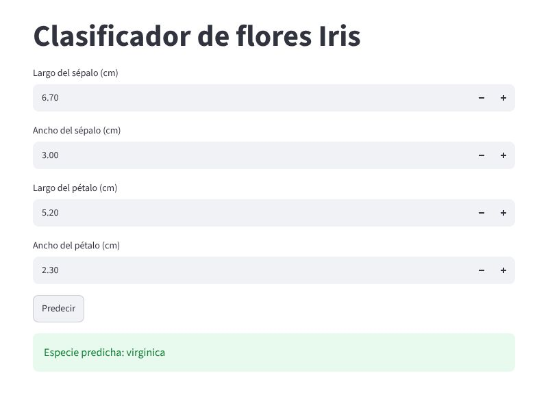

```{=typst}
#align(center)[#image("img/logo3.jpg", height: 1.9cm)]
#align(center)[#text(style: "italic", size: 10pt)[Laboratorio en Ciencia de Datos & Inteligencia Artificial \ Instituto Superior de Formación Técnica N°189]]
#line(length: 100%, stroke: 0.5pt)
#v(0.6em)
#align(center)[#text(weight: "bold", size: 12pt)[#underline[GUÍA PRÁCTICA: DOCKERFILE]] #linebreak() #v(0.3em) #text(size: 10.5pt)[Del modelo entrenado a la API en un contenedor]]
```

::: {.content-visible when-format="html"}
```{=html}
<div style="text-align:center"><p style="font-style:italic;margin:.6em 0 0">Laboratorio en Ciencia de Datos &amp; Inteligencia Artificial<br>Instituto Superior de Formación Técnica N°189</p><hr><h1 class="title" style="text-decoration:underline">GUÍA PRÁCTICA: DOCKERFILE</h1><p>Del modelo entrenado a la API en un contenedor</p></div>
```
:::

# Introducción

En esta guía se construye, paso a paso, un contenedor Docker que expone un modelo de aprendizaje automático a través de una API. Se parte de un modelo entrenado con Python, se escribe la API con FastAPI, se define el entorno en un **Dockerfile** y, por último, se suma una interfaz web con Streamlit usando **Docker Compose**. Es la misma estructura que pide la entrega 04: un servicio que recibe datos nuevos y devuelve predicciones, y una interfaz que lo consume.

El ejemplo usa el dataset Iris porque viene incluido en scikit-learn y no requiere descargas. Al terminar, reemplace el modelo y los datos por los de su proyecto. Antes de empezar, instale Docker siguiendo la *Guía de instalación: Docker*.

# Estructura del proyecto

Cree una carpeta con la siguiente estructura. La API y la interfaz van en carpetas separadas porque cada una se ejecuta en su propio contenedor.

```text
proyecto/
├── api/
│   ├── entrenar.py        # entrena el modelo y lo guarda
│   ├── api.py             # expone el modelo como servicio
│   ├── modelo.joblib      # modelo entrenado (lo genera entrenar.py)
│   ├── requirements.txt   # librerías de la API, con versión
│   ├── Dockerfile         # instrucciones para construir la imagen
│   └── .dockerignore      # archivos que no se copian a la imagen
├── interfaz/
│   ├── app.py
│   ├── requirements.txt
│   └── Dockerfile
└── docker-compose.yml
```

# Entrenar y guardar el modelo

El contenedor no entrena: recibe un modelo ya entrenado y lo usa para predecir. Por eso el primer paso es guardar el modelo en un archivo con `joblib`.

Archivo `api/entrenar.py`:

```python
# Entrena el modelo y lo guarda en modelo.joblib
import joblib
from sklearn.datasets import load_iris
from sklearn.ensemble import RandomForestClassifier
from sklearn.model_selection import train_test_split

X, y = load_iris(return_X_y=True, as_frame=True)
X_train, X_test, y_train, y_test = train_test_split(
    X, y, test_size=0.2, random_state=42, stratify=y
)

modelo = RandomForestClassifier(n_estimators=100, random_state=42)
modelo.fit(X_train, y_train)
print(f"Accuracy en prueba: {modelo.score(X_test, y_test):.3f}")

joblib.dump(modelo, "modelo.joblib")
```

Ejecútelo desde la carpeta `api` con `python entrenar.py`. Se crea el archivo `modelo.joblib`.

# La API

La API carga el modelo una sola vez, al iniciar, y ofrece dos rutas: `/`, para comprobar que el servicio está activo, y `/predecir`, que recibe las cuatro medidas de una flor en formato JSON y devuelve la especie. La clase `Flor` define qué datos espera la API; si falta un campo o tiene un tipo incorrecto, FastAPI responde con un error que explica el problema.

Archivo `api/api.py`:

```python
# API que expone el modelo entrenado
import joblib
import pandas as pd
from fastapi import FastAPI
from pydantic import BaseModel

CLASES = ["setosa", "versicolor", "virginica"]
modelo = joblib.load("modelo.joblib")

app = FastAPI(title="API del modelo Iris")


class Flor(BaseModel):
    largo_sepalo: float
    ancho_sepalo: float
    largo_petalo: float
    ancho_petalo: float


@app.get("/")
def estado():
    return {"estado": "ok"}


@app.post("/predecir")
def predecir(flor: Flor):
    fila = pd.DataFrame([[flor.largo_sepalo, flor.ancho_sepalo,
                          flor.largo_petalo, flor.ancho_petalo]],
                        columns=modelo.feature_names_in_)
    clase = int(modelo.predict(fila)[0])
    return {"especie": CLASES[clase]}
```

# El archivo requirements.txt

Lista las librerías que necesita la API **con su versión exacta**. Si se escribe solo `pandas`, cada vez que se construya la imagen se instalará la última versión disponible y el modelo puede dejar de funcionar. La versión de scikit-learn tiene que coincidir con la que se usó para entrenar; para consultarla, ejecute `pip freeze` en el entorno donde entrenó.

Archivo `api/requirements.txt`:

```text
fastapi==0.143.0
uvicorn==0.53.0
pandas==3.0.5
scikit-learn==1.9.1
joblib==1.6.0
```

# El Dockerfile

El Dockerfile es un archivo de texto, sin extensión, con las instrucciones para construir la **imagen**: una plantilla que contiene el sistema base, Python, las librerías y el código. A partir de esa imagen se crean los **contenedores**, que son la aplicación en ejecución.

Archivo `api/Dockerfile`:

```dockerfile
FROM python:3.12-slim

WORKDIR /app

COPY requirements.txt .
RUN pip install --no-cache-dir -r requirements.txt

COPY api.py modelo.joblib ./

EXPOSE 8000

CMD ["uvicorn", "api:app", "--host", "0.0.0.0", "--port", "8000"]
```

Cada instrucción cumple una función:

| Instrucción | Qué hace |
|:------|:----------|
| `FROM python:3.12-slim` | Parte de una imagen oficial con Python 3.12 instalado. La variante *slim* es más liviana. |
| `WORKDIR /app` | Crea la carpeta `/app` dentro del contenedor y se ubica en ella. |
| `COPY requirements.txt .` | Copia la lista de librerías desde su computadora a la imagen. |
| `RUN pip install ...` | Instala las librerías mientras se construye la imagen. |
| `COPY api.py modelo.joblib ./` | Copia el código de la API y el modelo entrenado. |
| `EXPOSE 8000` | Documenta el puerto que usa la aplicación. |
| `CMD [...]` | Indica el comando que se ejecuta al iniciar el contenedor: levantar la API con uvicorn. |

: {tbl-colwidths="[38,62]"}

Observe el orden: primero se copian e instalan las librerías y después el código. Docker guarda cada paso como una **capa** y, si un paso no cambió, reutiliza la capa anterior. Como el código cambia seguido y las librerías no, este orden evita reinstalar todo en cada construcción.

El parámetro `--host 0.0.0.0` es necesario: indica que la API acepte conexiones desde fuera del contenedor. Con el valor por defecto (`127.0.0.1`), la API solo sería accesible desde adentro.

# El archivo .dockerignore

Funciona como un `.gitignore`: indica qué archivos no deben copiarse a la imagen. Así la imagen queda más chica y no se incluyen datos que no corresponde distribuir.

Archivo `api/.dockerignore`:

```text
__pycache__/
*.ipynb
.venv/
datos/
```

# Construir y ejecutar

Desde la carpeta `api`, construya la imagen. La opción `-t` le asigna un nombre y el punto final indica que el Dockerfile está en la carpeta actual.

```bash
docker build -t api-modelo .
```

Luego cree un contenedor a partir de la imagen. La opción `-p 8000:8000` conecta el puerto 8000 de su computadora con el 8000 del contenedor, y `-d` lo deja corriendo en segundo plano.

```bash
docker run -d -p 8000:8000 --name api api-modelo
```

Pruebe la API desde otra terminal (en Windows, use `curl.exe` en lugar de `curl` si trabaja en PowerShell):

```bash
curl -X POST http://localhost:8000/predecir -H "Content-Type: application/json" -d "{\"largo_sepalo\": 6.7, \"ancho_sepalo\": 3.0, \"largo_petalo\": 5.2, \"ancho_petalo\": 2.3}"
```

La respuesta debe ser `{"especie":"virginica"}`. También puede abrir `http://localhost:8000/docs` en el navegador: FastAPI genera una página donde se prueba cada ruta completando un formulario.

Otros comandos útiles:

```bash
docker ps              # contenedores en ejecución
docker logs api        # mensajes de la API (errores incluidos)
docker stop api        # detener el contenedor
docker rm api          # eliminarlo
```

# La interfaz y Docker Compose

La interfaz es una aplicación de Streamlit que muestra un formulario, envía los datos a la API y presenta la respuesta. La dirección de la API se lee de la variable de entorno `API_URL`, para poder cambiarla sin tocar el código.

Archivo `interfaz/app.py`:

```python
# Interfaz web que consume la API
import os

import requests
import streamlit as st

API_URL = os.getenv("API_URL", "http://localhost:8000")

st.title("Clasificador de flores Iris")

largo_sepalo = st.number_input("Largo del sépalo (cm)", value=5.1)
ancho_sepalo = st.number_input("Ancho del sépalo (cm)", value=3.5)
largo_petalo = st.number_input("Largo del pétalo (cm)", value=1.4)
ancho_petalo = st.number_input("Ancho del pétalo (cm)", value=0.2)

if st.button("Predecir"):
    datos = {
        "largo_sepalo": largo_sepalo,
        "ancho_sepalo": ancho_sepalo,
        "largo_petalo": largo_petalo,
        "ancho_petalo": ancho_petalo,
    }
    respuesta = requests.post(f"{API_URL}/predecir", json=datos, timeout=10)
    st.success(f"Especie predicha: {respuesta.json()['especie']}")
```

Archivo `interfaz/requirements.txt`:

```text
streamlit==1.65.0
requests==2.34.2
```

Archivo `interfaz/Dockerfile`:

```dockerfile
FROM python:3.12-slim

WORKDIR /app

COPY requirements.txt .
RUN pip install --no-cache-dir -r requirements.txt

COPY app.py .

EXPOSE 8501

CMD ["streamlit", "run", "app.py", "--server.address=0.0.0.0", "--server.port=8501"]
```

Para no levantar cada contenedor a mano, Docker Compose los define en un único archivo, ubicado en la carpeta raíz del proyecto:

Archivo `docker-compose.yml`:

```yaml
services:
  api:
    build: ./api
    ports:
      - "8000:8000"

  interfaz:
    build: ./interfaz
    ports:
      - "8501:8501"
    environment:
      - API_URL=http://api:8000
    depends_on:
      - api
```

Dentro de la red que crea Compose, cada servicio se encuentra por su nombre: por eso la interfaz llama a `http://api:8000` y no a `localhost`. Detenga el contenedor del paso anterior (`docker stop api`) y, desde la carpeta `proyecto`, ejecute:

```bash
docker compose up --build
```

Abra `http://localhost:8501` en el navegador, complete las medidas y presione **Predecir**.

{width=75% fig-align="center"}

Para detener todo, presione `Ctrl+C` en la terminal o ejecute `docker compose down`.

# Publicar la imagen en Docker Hub

Hasta ahora la imagen existe solo en su computadora. Para usarla en otra máquina (un servidor del instituto, una máquina virtual en la nube o la computadora de un compañero) hay que publicarla en un **registro**. El registro público más usado es Docker Hub (<https://hub.docker.com>), donde también están las imágenes oficiales como `python:3.12-slim`.

1. Cree una cuenta gratuita en Docker Hub. Su nombre de usuario va a formar parte del nombre de cada imagen.
2. Inicie sesión desde la terminal. Docker le indica un código para confirmar en el navegador; también puede ingresar su usuario y un *token* de acceso creado en la configuración de su cuenta, en lugar de la contraseña.

```bash
docker login
```

3. Asigne a la imagen un nombre con el formato `usuario/repositorio:etiqueta`. La etiqueta identifica la versión; conviene usar números (`1.0`, `1.1`) en lugar de depender solo de `latest`.

```bash
docker tag api-modelo su-usuario/api-modelo:1.0
```

4. Suba la imagen. Si el repositorio no existe, Docker Hub lo crea como público.

```bash
docker push su-usuario/api-modelo:1.0
```

5. Desde cualquier otra máquina con Docker, la imagen se descarga y se ejecuta sin copiar código ni instalar librerías:

```bash
docker run -d -p 8000:8000 su-usuario/api-modelo:1.0
```

En Docker Compose, para usar la imagen publicada en lugar de construirla, se reemplaza `build: ./api` por `image: su-usuario/api-modelo:1.0`.

Tenga en cuenta dos detalles:

- **Una imagen pública la puede descargar cualquiera.** No incluya datos personales, contraseñas ni claves de acceso dentro de la imagen.
- **La arquitectura importa.** Una imagen construida en una Mac con chip Apple (ARM) puede no correr en un servidor con procesador Intel o AMD. Para construir y publicar para ambas arquitecturas a la vez, use:

```bash
docker buildx build --platform linux/amd64,linux/arm64 -t su-usuario/api-modelo:1.0 --push .
```

# Errores frecuentes

| Problema | Causa y solución |
|:--|:--------|
| `Cannot connect to the Docker daemon` | Docker Desktop no está abierto. Ábralo y espere a que indique que está en ejecución. |
| `port is already allocated` | Otro contenedor o programa usa el puerto. Detenga el contenedor anterior o cambie el puerto de la izquierda, por ejemplo `-p 8080:8000`. |
| La API no responde desde el navegador | Falta `--host 0.0.0.0` en el `CMD` o falta `-p` en `docker run`. |
| `No such file or directory: 'modelo.joblib'` | No se ejecutó `entrenar.py` o el modelo no se copió en el Dockerfile. |
| Advertencias de versión al cargar el modelo | La versión de scikit-learn de `requirements.txt` no coincide con la del entrenamiento. |
| `denied: requested access to the resource is denied` al hacer `push` | No inició sesión con `docker login` o el nombre de la imagen no empieza con su usuario de Docker Hub. |
| `exec format error` al ejecutar una imagen descargada | La imagen se construyó para otra arquitectura. Publíquela con `docker buildx` para `linux/amd64` y `linux/arm64`. |
| La interfaz muestra `Connection refused` | Usa `localhost` en lugar del nombre del servicio (`api`) dentro de Compose. |

: {tbl-colwidths="[38,62]"}

# Consignas

1. Reproduzca el ejemplo completo y verifique que la interfaz devuelve una predicción.
2. Adapte el ejemplo a su proyecto:
    a. Guarde su modelo entrenado con `joblib`.
    b. Modifique la clase de entrada de la API para que reciba los atributos de su dataset.
    c. Arme el `requirements.txt` con las versiones exactas de su entorno de entrenamiento.
3. Construya la imagen de su API y pruébela con `curl` o desde `/docs`.
4. Sume la interfaz con Docker Compose. Este es el punto de partida técnico de la entrega 04.
5. Publique la imagen de su API en Docker Hub con una etiqueta de versión y verifique que un compañero puede ejecutarla con `docker run`.

Podrá ayudarse con Modelos de Lenguaje, como Gemini y soluciones basadas en GPT, para adaptar el código a su proyecto.

# Referencias

- Docker Inc. *Dockerfile reference*. <https://docs.docker.com/reference/dockerfile/>
- Docker Inc. *Docker Compose*. <https://docs.docker.com/compose/>
- Docker Inc. *Docker Hub: repositories*. <https://docs.docker.com/docker-hub/repos/>
- FastAPI. *FastAPI in Containers - Docker*. <https://fastapi.tiangolo.com/deployment/docker/>
- Streamlit. *Deploy Streamlit using Docker*. <https://docs.streamlit.io/deploy/tutorials/docker>
