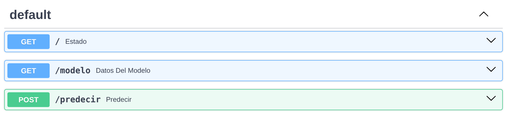
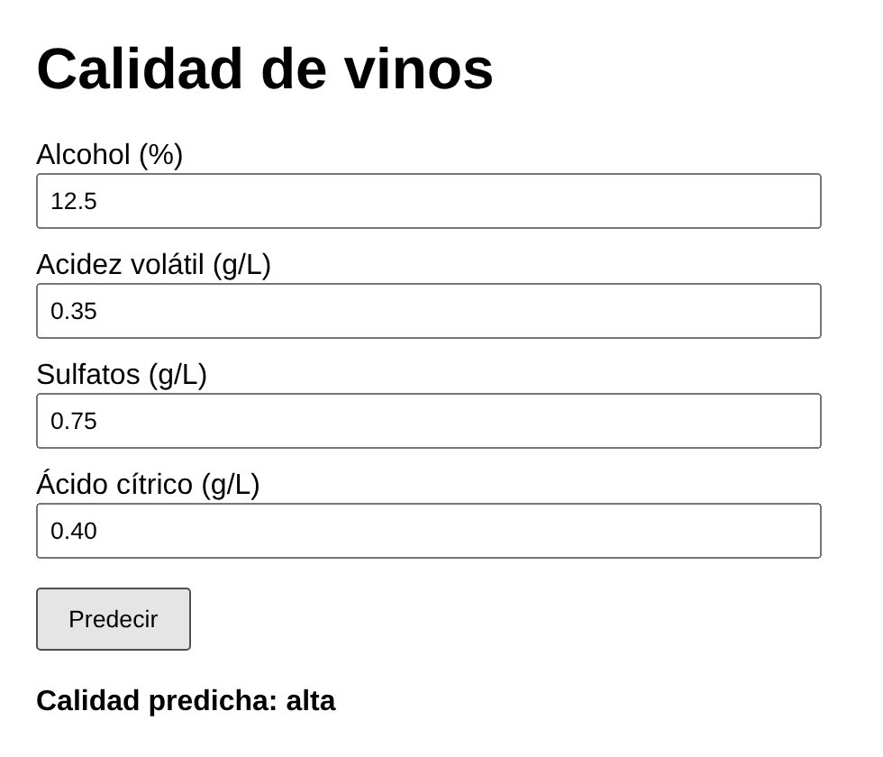

```{=typst}
#align(center)[#image("img/logo3.jpg", height: 1.9cm)]
#align(center)[#text(style: "italic", size: 10pt)[Laboratorio en Ciencia de Datos & Inteligencia Artificial \ Instituto Superior de Formación Técnica N°189]]
#line(length: 100%, stroke: 0.5pt)
#v(0.6em)
#align(center)[#text(weight: "bold", size: 12pt)[#underline[GUÍA PRÁCTICA: MODELOS COMO SERVICIO CON FASTAPI]] #linebreak() #v(0.3em) #text(size: 10.5pt)[Persistir un modelo, servirlo con una API y consumirlo desde una página web]]
```

::: {.content-visible when-format="html"}
```{=html}
<div style="text-align:center"><p style="font-style:italic;margin:.6em 0 0">Laboratorio en Ciencia de Datos &amp; Inteligencia Artificial<br>Instituto Superior de Formación Técnica N°189</p><hr><h1 class="title" style="text-decoration:underline">GUÍA PRÁCTICA: MODELOS COMO SERVICIO CON FASTAPI</h1><p>Persistir un modelo, servirlo con una API y consumirlo desde una página web</p></div>
```
:::

# Introducción

En la clase de APIs trabajamos como **consumidores**: desde una notebook enviamos pedidos a servicios de terceros (GitHub, YouTube, Reddit) y recibimos datos en formato JSON. En esta guía cambiamos de rol y pasamos a ser **proveedores**: tomamos un modelo de aprendizaje automático entrenado, lo guardamos en un archivo y lo publicamos a través de una API propia, de modo que cualquier aplicación pueda pedirle predicciones sin conocer cómo fue construido.

La solución tiene tres piezas, cada una en su propio archivo:

| Pieza | Archivo | Responsabilidad |
|:--|:--|:----------|
| Entrenamiento | `entrenar.py` | Carga los datos, entrena el modelo y lo guarda en disco junto con sus metadatos. Se ejecuta una sola vez. |
| Servicio | `api.py` | Carga el modelo guardado y expone rutas HTTP que reciben datos y devuelven predicciones. Queda siempre activo. |
| Cliente | `index.html` | Página web con un formulario que envía los datos a la API y muestra la respuesta. |

: {tbl-colwidths="[18,18,64]"}

El ejemplo usa el dataset **Wine Quality** del repositorio UCI, el mismo de la notebook modelo del segundo entregable, y la misma etiqueta de calidad (baja, media o alta). Al terminar, reemplace el dataset y las variables por los de su proyecto. El código completo está en la carpeta [`modelo-api`](https://github.com/jumafernandez/eda-isft189/tree/main/modelo-api) del repositorio del curso.

# Estructura y entorno

Cree una carpeta con la siguiente estructura:

```text
modelo-api/
├── entrenar.py          # entrena el modelo y lo guarda
├── api.py               # sirve el modelo a través de HTTP
├── index.html           # cliente web que consume la API
└── requirements.txt     # librerías con su versión
```

Es recomendable trabajar en un entorno virtual, para que las librerías del proyecto no se mezclen con las del sistema. Desde la carpeta `modelo-api`:

```bash
python -m venv .venv
source .venv/bin/activate        # en Windows: .venv\Scripts\activate
pip install -r requirements.txt
```

Archivo `requirements.txt`:

```text
fastapi==0.143.0
uvicorn==0.53.0
pandas==3.0.5
scikit-learn==1.9.1
joblib==1.6.0
ucimlrepo==0.0.7
```

Las versiones se fijan porque un modelo guardado con una versión de scikit-learn puede no cargarse, o comportarse distinto, con otra.

# Persistir el modelo

**Persistir** (o serializar) un modelo es guardar en un archivo el objeto que está en la memoria de Python, para volver a cargarlo más tarde sin reentrenar. Las opciones más comunes son:

| Formato | Características |
|:--|:----------|
| `pickle` | Módulo estándar de Python; guarda cualquier objeto. |
| `joblib` | Más eficiente con arreglos de NumPy. Es la opción que recomienda scikit-learn. |
| ONNX | Formato abierto que permite usar el modelo desde otros lenguajes y plataformas. |

: {tbl-colwidths="[20,80]"}

Dos decisiones importantes:

- **Guardar el pipeline completo, no solo el clasificador.** Si el modelo se entrenó con datos escalados, la API tiene que aplicar exactamente el mismo escalado a cada dato nuevo. Un `Pipeline` de scikit-learn une la transformación y el modelo en un solo objeto, de modo que al guardarlo se guardan ambos.
- **Guardar metadatos en un archivo legible.** El `.joblib` es binario. Un JSON al lado documenta qué variables espera el modelo, en qué orden, qué clases puede devolver, cuándo se entrenó y con qué versión de scikit-learn.

Archivo `entrenar.py`:

```python
# Entrena el modelo de calidad de vinos y lo guarda en disco
import json
from datetime import datetime

import joblib
import sklearn
from sklearn.ensemble import RandomForestClassifier
from sklearn.metrics import accuracy_score, f1_score
from sklearn.model_selection import train_test_split
from sklearn.pipeline import Pipeline
from sklearn.preprocessing import StandardScaler
from ucimlrepo import fetch_ucirepo

# 1. Datos: Wine Quality (UCI), el mismo dataset de la notebook modelo
wine = fetch_ucirepo(id=186)
df = wine.data.features.copy()
df["quality"] = wine.data.targets["quality"]

# Variable objetivo categórica, igual que en la notebook
def categorizar(puntaje):
    if puntaje <= 4:
        return "baja"
    elif puntaje <= 6:
        return "media"
    else:
        return "alta"


df["calidad"] = df["quality"].apply(categorizar)

# Para que el ejemplo sea simple usamos solo cuatro variables
VARIABLES = ["alcohol", "volatile_acidity", "sulphates", "citric_acid"]
X = df[VARIABLES]
y = df["calidad"]

X_train, X_test, y_train, y_test = train_test_split(
    X, y, test_size=0.2, random_state=42, stratify=y
)

# 2. Pipeline: la transformación y el modelo viajan juntos
#    (un árbol no necesita escalado; se incluye para mostrar cómo se guarda
#    una transformación junto al modelo, como las de la notebook modelo)
modelo = Pipeline([
    ("escalado", StandardScaler()),
    ("clasificador", RandomForestClassifier(
        n_estimators=200, class_weight="balanced", random_state=42)),
])
modelo.fit(X_train, y_train)

y_pred = modelo.predict(X_test)
accuracy = accuracy_score(y_test, y_pred)
f1_macro = f1_score(y_test, y_pred, average="macro")
print(f"Accuracy en prueba: {accuracy:.3f} | F1 macro: {f1_macro:.3f}")

# 3. Persistencia: el modelo en un archivo binario...
joblib.dump(modelo, "modelo.joblib")

# ...y sus metadatos en un JSON legible
info = {
    "nombre": "Clasificador de calidad de vinos",
    "version": "1.0",
    "fecha_entrenamiento": datetime.now().isoformat(timespec="seconds"),
    "variables": VARIABLES,
    "clases": list(modelo.classes_),
    "accuracy_prueba": round(accuracy, 3),
    "f1_macro_prueba": round(f1_macro, 3),
    "scikit_learn": sklearn.__version__,
}
with open("modelo_info.json", "w", encoding="utf-8") as f:
    json.dump(info, f, ensure_ascii=False, indent=2)

print("Modelo guardado en modelo.joblib y metadatos en modelo_info.json")
```

Ejecútelo una vez:

```bash
python entrenar.py
```

Se crean `modelo.joblib` y `modelo_info.json`, y la terminal muestra las métricas en el conjunto de prueba (accuracy 0.816 y F1 macro 0.613). El objetivo del ejemplo no es lograr el mejor modelo sino mostrar el circuito completo. Como las clases están desbalanceadas (77 % de los vinos son de calidad media), se usa `class_weight="balanced"` y se informa también el F1 macro, que pesa por igual a las tres clases.

::: {.callout-warning}
`joblib.load` y `pickle.load` pueden ejecutar código al cargar un archivo. Cargue solo modelos que haya generado usted o que provengan de una fuente confiable.
:::

# Diseñar la API

Antes de escribir código, el arquitecto define el **contrato** de la API: qué rutas existen, qué recibe cada una y qué devuelve. El cliente solo necesita conocer este contrato; no necesita saber qué algoritmo hay detrás.

| Método y ruta | Recibe | Devuelve |
|:--|:--|:----------|
| `GET /` | Nada | `{"estado": "ok"}`, para comprobar que el servicio está activo. |
| `GET /modelo` | Nada | Los metadatos del modelo (el contenido de `modelo_info.json`). |
| `POST /predecir` | JSON con las cuatro variables de un vino | La calidad predicha y la probabilidad de cada clase. |

: {tbl-colwidths="[24,26,50]"}

Se usa `POST` en `/predecir` porque el cliente envía datos en el cuerpo del pedido para que el servidor los procese. Un ejemplo de pedido y respuesta:

```text
POST /predecir
Content-Type: application/json

{"alcohol": 12.5, "volatile_acidity": 0.35, "sulphates": 0.75, "citric_acid": 0.4}

Respuesta 200 OK:
{"calidad": "alta", "probabilidades": {"alta": 0.885, "baja": 0.01, "media": 0.105}}
```

# FastAPI paso a paso

**FastAPI** es un framework de Python para construir APIs web. Antes de ver el archivo completo, conviene construir la API de a poco, probando cada paso. Así queda claro qué hace cada pieza.

## Paso 1: las piezas

Una API con FastAPI combina tres librerías, que se instalan con `requirements.txt`:

| Pieza | Qué hace |
|:--|:----------|
| `fastapi` | Define la aplicación y sus rutas: qué función responde a cada método y URL. |
| `pydantic` | Describe la forma de los datos de entrada y los valida. Se instala junto con FastAPI. |
| `uvicorn` | Es el servidor web: escucha en un puerto, recibe los pedidos HTTP y se los pasa a la aplicación. |

: {tbl-colwidths="[18,82]"}

FastAPI no es un servidor por sí mismo; describe *qué responder*. Uvicorn es el programa que queda corriendo y *atiende* los pedidos.

## Paso 2: la API mínima

Cree un archivo `api.py` con este contenido:

```python
from fastapi import FastAPI

app = FastAPI(title="API de calidad de vinos")


@app.get("/")
def estado():
    return {"estado": "ok"}
```

Línea por línea:

- `app = FastAPI(...)` crea la aplicación. La variable `app` es el objeto que después va a buscar uvicorn.
- `@app.get("/")` es un **decorador**: le indica a FastAPI que cuando llegue un pedido `GET` a la ruta `/`, debe ejecutar la función que está justo debajo.
- La función devuelve un diccionario de Python. FastAPI lo convierte automáticamente en JSON y lo envía como respuesta con el código 200.

El nombre de la función (`estado`) no forma parte de la URL; solo se usa como título en la documentación.

## Paso 3: levantar el servidor

Desde la carpeta donde está `api.py`:

```bash
uvicorn api:app --reload
```

`api:app` significa "en el archivo `api.py`, usar la variable `app`". Si el archivo se llamara `main.py`, el comando sería `uvicorn main:app`. La terminal muestra `Uvicorn running on http://127.0.0.1:8000`; a partir de ahí la API está escuchando pedidos. Abra `http://localhost:8000` en el navegador y verá `{"estado":"ok"}`.

La opción `--reload` reinicia el servidor cada vez que guarda un cambio en el código, algo útil mientras se desarrolla. Para detener el servidor, presione `Ctrl+C` en la terminal.

## Paso 4: la documentación automática

Sin escribir nada más, FastAPI ya ofrece dos direcciones:

- `http://localhost:8000/docs`: una página interactiva (Swagger UI) con todas las rutas, donde se pueden probar completando formularios.
- `http://localhost:8000/openapi.json`: la descripción formal de la API en el estándar **OpenAPI**. Es la que usa la página `/docs`, y otras herramientas pueden leerla para generar clientes automáticamente.

Cada ruta que se agregue en los pasos siguientes aparece sola en `/docs`.

## Paso 5: recibir datos con Pydantic

Para predecir, la API tiene que recibir las variables de un vino. Esos datos llegan en el **cuerpo** del pedido, en formato JSON, y se describen con una clase que hereda de `BaseModel`:

```python
from pydantic import BaseModel


class Vino(BaseModel):
    alcohol: float
    volatile_acidity: float
    sulphates: float
    citric_acid: float


@app.post("/predecir")
def predecir(vino: Vino):
    return {"recibido": vino.model_dump()}
```

Cuando la función tiene un parámetro cuyo tipo es una clase de Pydantic, FastAPI entiende que debe leer el cuerpo del pedido y hace todo esto antes de ejecutar la función:

1. Lee el JSON del cuerpo.
2. Verifica que estén los cuatro campos y que cada uno sea un número.
3. Si algo falla, responde **422** con el detalle del error y la función ni se ejecuta.
4. Si todo está bien, crea un objeto `Vino` y se lo pasa a la función.

Dentro de la función, cada valor se lee como un atributo (`vino.alcohol`) y `vino.model_dump()` lo convierte en un diccionario. Pruebe la ruta desde `/docs` con **Try it out**: la página ya muestra un JSON de ejemplo con los cuatro campos, porque lo toma de la clase `Vino`.

## Paso 6: validar rangos

Saber que un valor es un número no alcanza: una graduación alcohólica de 45 % o negativa no tiene sentido para el modelo. `Field` permite agregar restricciones:

```python
from pydantic import BaseModel, Field


class Vino(BaseModel):
    alcohol: float = Field(ge=0, le=20, description="Graduación alcohólica (%)")
    volatile_acidity: float = Field(ge=0, le=2, description="Acidez volátil (g/L)")
    sulphates: float = Field(ge=0, le=3, description="Sulfatos (g/L)")
    citric_acid: float = Field(ge=0, le=2, description="Ácido cítrico (g/L)")
```

`ge` significa *mayor o igual* (*greater or equal*) y `le`, *menor o igual* (*less or equal*). La `description` aparece en `/docs`. Los rangos conviene definirlos a partir del análisis exploratorio: los mínimos y máximos observados, con algo de margen.

## Paso 7: conectar el modelo

Ahora la ruta deja de devolver lo recibido y usa el modelo. El modelo se carga **una sola vez**, al principio del archivo, fuera de las funciones:

```python
import joblib
import pandas as pd

modelo = joblib.load("modelo.joblib")


@app.post("/predecir")
def predecir(vino: Vino):
    fila = pd.DataFrame([vino.model_dump()])
    clase = modelo.predict(fila)[0]
    return {"calidad": clase}
```

Como el código de arriba del archivo se ejecuta una vez, cuando uvicorn inicia la aplicación, el modelo queda en memoria y cada pedido lo reutiliza. Si `joblib.load` estuviera dentro de `predecir`, el archivo se leería en cada pedido. La fila se arma como un `DataFrame` de una sola fila porque el pipeline se entrenó con un `DataFrame` y espera las mismas columnas.

## Paso 8: habilitar CORS

Por último, para que una página web pueda consultar la API desde el navegador, se agrega el middleware de CORS (se explica en detalle en la sección del cliente HTML):

```python
from fastapi.middleware.cors import CORSMiddleware

app.add_middleware(CORSMiddleware, allow_origins=["*"],
                   allow_methods=["*"], allow_headers=["*"])
```

Un **middleware** es código que se ejecuta en todos los pedidos, antes y después de la función de la ruta. Este agrega a cada respuesta los encabezados que le indican al navegador que la página tiene permiso para leerla.

## Qué pasa en cada pedido

Con todas las piezas juntas, cuando la página envía un `POST /predecir`:

1. Uvicorn recibe el pedido HTTP en el puerto 8000 y se lo entrega a la aplicación.
2. El middleware de CORS lo deja pasar.
3. FastAPI busca qué función corresponde a `POST /predecir`.
4. Pydantic lee y valida el JSON. Si hay un error, responde 422 y el proceso termina acá.
5. Se ejecuta `predecir`, que usa el modelo ya cargado en memoria.
6. FastAPI convierte el diccionario devuelto en JSON y responde con código 200.
7. El middleware agrega los encabezados de CORS y la respuesta vuelve al navegador.

## Vocabulario

| Término | Significado |
|:--|:----------|
| Ruta (*endpoint*) | Combinación de método HTTP y URL, por ejemplo `POST /predecir`. |
| Decorador | La línea con `@` sobre una función. En FastAPI asocia la función a una ruta. |
| Cuerpo (*body*) | Los datos que el cliente envía en un pedido `POST`, en este caso un JSON. |
| Modelo de Pydantic | Clase que describe y valida los datos de entrada. No confundir con el modelo de aprendizaje automático. |
| Uvicorn | Servidor que atiende los pedidos HTTP y los pasa a la aplicación de FastAPI. |
| OpenAPI | Estándar para describir APIs. FastAPI lo genera solo y lo muestra en `/docs`. |
| Middleware | Código que se ejecuta en todos los pedidos, como el de CORS. |

: {tbl-colwidths="[28,72]"}

## El archivo completo

Juntando los pasos, y sumando la ruta `/modelo` y las probabilidades de cada clase, queda el archivo `api.py` del ejemplo:

Archivo `api.py`:

```python
# API que sirve el modelo entrenado
import json

import joblib
import pandas as pd
from fastapi import FastAPI
from fastapi.middleware.cors import CORSMiddleware
from pydantic import BaseModel, Field

# El modelo se carga una sola vez, al iniciar la API
modelo = joblib.load("modelo.joblib")
with open("modelo_info.json", encoding="utf-8") as f:
    info = json.load(f)

app = FastAPI(title="API de calidad de vinos")

# Permite que una página web abierta en el navegador consulte la API
app.add_middleware(CORSMiddleware, allow_origins=["*"],
                   allow_methods=["*"], allow_headers=["*"])


# Datos que espera la API: nombre, tipo y rango de cada variable
class Vino(BaseModel):
    alcohol: float = Field(ge=0, le=20, description="Graduación alcohólica (%)")
    volatile_acidity: float = Field(ge=0, le=2, description="Acidez volátil (g/L)")
    sulphates: float = Field(ge=0, le=3, description="Sulfatos (g/L)")
    citric_acid: float = Field(ge=0, le=2, description="Ácido cítrico (g/L)")


@app.get("/")
def estado():
    return {"estado": "ok"}


@app.get("/modelo")
def datos_del_modelo():
    return info


@app.post("/predecir")
def predecir(vino: Vino):
    fila = pd.DataFrame([vino.model_dump()])[info["variables"]]
    clase = modelo.predict(fila)[0]
    probabilidades = modelo.predict_proba(fila)[0]
    return {
        "calidad": clase,
        "probabilidades": {c: round(float(p), 3)
                           for c, p in zip(modelo.classes_, probabilidades)},
    }
```

Respecto de los pasos anteriores, el archivo completo agrega dos detalles:

- La fila se arma con las columnas en el orden que indica `modelo_info.json`, que es el mismo orden usado al entrenar. Así el resultado no depende del orden en que estén escritos los campos de la clase `Vino`.
- Además de la clase, devuelve la probabilidad de cada una con `predict_proba`, útil para saber qué tan seguro está el modelo.

# Probar la API

Con la API corriendo, abra `http://localhost:8000/docs` en el navegador. FastAPI genera una página con todas las rutas. En `POST /predecir`, presione **Try it out**, complete el JSON de entrada y presione **Execute**: debajo aparece la respuesta con su código HTTP.

{width=85% fig-align="center"}

También puede probarla desde la terminal (en Windows, use `curl.exe` si trabaja en PowerShell):

```bash
curl -X POST http://localhost:8000/predecir -H "Content-Type: application/json" -d "{\"alcohol\": 12.5, \"volatile_acidity\": 0.35, \"sulphates\": 0.75, \"citric_acid\": 0.4}"
```

O desde Python, como hicimos en la clase de APIs, ahora contra nuestro propio servicio:

```python
import requests

vino = {"alcohol": 9.4, "volatile_acidity": 0.9, "sulphates": 0.5, "citric_acid": 0.0}
respuesta = requests.post("http://localhost:8000/predecir", json=vino)
print(respuesta.status_code, respuesta.json())
```

## Validación de los datos

Si el pedido trae un valor fuera de rango, un campo faltante o un texto donde va un número, FastAPI lo rechaza con el código **422** y explica el problema. Por ejemplo, con `"alcohol": 45`:

```text
422 Unprocessable Entity
{"detail": [{"type": "less_than_equal", "loc": ["body", "alcohol"],
             "msg": "Input should be less than or equal to 20", "input": 45}]}
```

Así el modelo nunca recibe datos inválidos. Los códigos HTTP también forman parte del contrato: **200** (todo bien), **422** (datos inválidos), **404** (ruta inexistente) y **500** (error del servidor).

# Consumir la API desde una página HTML

El cliente más simple es una página web con un formulario. Al presionar el botón, JavaScript arma un JSON con los valores, lo envía a la API con `fetch` y muestra la respuesta. No necesita ningún servidor: el archivo se abre directamente en el navegador.

Archivo `index.html`:

```html
<!DOCTYPE html>
<html lang="es">
<head>
  <meta charset="UTF-8">
  <title>Calidad de vinos</title>
  <style>
    body { font-family: sans-serif; max-width: 420px; margin: 40px auto; }
    label { display: block; margin-top: 12px; }
    input { width: 100%; padding: 6px; }
    button { margin-top: 16px; padding: 8px 16px; }
    #resultado { margin-top: 20px; font-weight: bold; }
  </style>
</head>
<body>
  <h1>Calidad de vinos</h1>

  <form id="formulario">
    <label>Alcohol (%)
      <input type="number" step="0.1" id="alcohol" value="12.5">
    </label>
    <label>Acidez volátil (g/L)
      <input type="number" step="0.01" id="volatile_acidity" value="0.35">
    </label>
    <label>Sulfatos (g/L)
      <input type="number" step="0.01" id="sulphates" value="0.75">
    </label>
    <label>Ácido cítrico (g/L)
      <input type="number" step="0.01" id="citric_acid" value="0.40">
    </label>
    <button type="submit">Predecir</button>
  </form>

  <p id="resultado"></p>

  <script>
    const API_URL = "http://localhost:8000";

    document.getElementById("formulario").addEventListener("submit", async (evento) => {
      evento.preventDefault();  // evita que la página se recargue

      // 1. Armar el JSON con los valores del formulario
      const datos = {
        alcohol: Number(document.getElementById("alcohol").value),
        volatile_acidity: Number(document.getElementById("volatile_acidity").value),
        sulphates: Number(document.getElementById("sulphates").value),
        citric_acid: Number(document.getElementById("citric_acid").value),
      };

      // 2. Enviarlo a la API con un POST
      const respuesta = await fetch(`${API_URL}/predecir`, {
        method: "POST",
        headers: { "Content-Type": "application/json" },
        body: JSON.stringify(datos),
      });

      // 3. Mostrar la respuesta
      const resultado = await respuesta.json();
      if (respuesta.ok) {
        document.getElementById("resultado").textContent =
          `Calidad predicha: ${resultado.calidad}`;
      } else {
        document.getElementById("resultado").textContent =
          "Error: revise los valores ingresados";
      }
    });
  </script>
</body>
</html>
```

Con la API corriendo, haga doble clic en `index.html`, complete los valores y presione **Predecir**.

{width=45% fig-align="center"}

## ¿Por qué hace falta CORS?

Por seguridad, el navegador bloquea los pedidos que una página hace a un servidor de **otro origen** (otro dominio, protocolo o puerto), salvo que ese servidor lo autorice explícitamente. Nuestra página (un archivo local) y la API (`localhost:8000`) son orígenes distintos; por eso `api.py` incluye el `CORSMiddleware`. Si lo quita, la API sigue funcionando en `/docs`, con `curl` o con Python, pero el `fetch` de la página falla y la consola del navegador (F12) muestra un error de CORS.

`allow_origins=["*"]` autoriza a cualquier origen, lo que es cómodo para aprender. En un servicio real se reemplaza por la lista de dominios que pueden consultar la API, por ejemplo `allow_origins=["https://mi-sitio.com"]`.

# Decisiones de arquitectura

Además del código, el ejemplo refleja decisiones que conviene sostener en cualquier servicio de modelos:

- **Separar entrenamiento y servicio.** Se entrena una vez; la API solo carga y predice.
- **Cargar el modelo una sola vez**, al iniciar el servicio.
- **Definir y validar el contrato** de entrada y salida.
- **Versionar** el modelo, el código y las librerías, y registrarlo en los metadatos.
- Ofrecer una **ruta de estado** para saber si el servicio está activo.
- **Restringir CORS** y no incluir claves ni datos sensibles en el código.
- **Responder errores con códigos HTTP claros** en lugar de dejar que el servicio se caiga.

El paso siguiente es empaquetar la API en un contenedor para que funcione igual en cualquier máquina; eso se trabaja en la [Guía práctica: Dockerfile](guia-dockerfile.qmd).

# Errores frecuentes

| Problema | Causa y solución |
|:--|:--------|
| `No such file or directory: 'modelo.joblib'` | No se ejecutó `python entrenar.py`, o se levantó la API desde otra carpeta. Ejecute `uvicorn` desde la carpeta donde están los archivos. |
| `Address already in use` | Otro proceso usa el puerto 8000. Cierre la otra API o use `uvicorn api:app --port 8001` (y actualice `API_URL` en el HTML). |
| Advertencias `InconsistentVersionWarning` al cargar el modelo | El modelo se guardó con otra versión de scikit-learn. Reentrene con las versiones de `requirements.txt`. |
| La página no muestra nada y la consola indica un error de CORS | Falta el `CORSMiddleware` en `api.py`. |
| La página muestra `Failed to fetch` | La API no está corriendo o `API_URL` apunta a otra dirección o puerto. |
| Respuesta `422` | Algún valor está fuera de rango, falta un campo o el nombre no coincide con la clase de entrada. Revise el detalle del error. |
| `KeyError` con el nombre de una columna | Las variables de la clase de entrada no coinciden con las usadas al entrenar. |

: {tbl-colwidths="[38,62]"}

# Consignas

1. Reproduzca el ejemplo completo: entrene el modelo, levante la API, pruébela en `/docs` y verifique que `index.html` muestra la predicción.
2. Agregue a la página el detalle de las probabilidades de cada clase que ya devuelve la API.
3. Adapte el ejemplo a su proyecto:
    a. Modifique `entrenar.py` para usar su dataset y guardar su pipeline con `joblib`, junto con su archivo de metadatos.
    b. Redefina la clase de entrada de la API con las variables de su proyecto y rangos válidos razonables.
    c. Adapte el formulario HTML a esas variables.
4. Documente en el repositorio de su proyecto el contrato de su API (rutas, entrada y salida) e incluya el `requirements.txt` con versiones exactas.

Podrá ayudarse con Modelos de Lenguaje, como Gemini y soluciones basadas en GPT, para adaptar el código a su proyecto.

# Referencias

- Cortez, P., Cerdeira, A., Almeida, F., Matos, T. y Reis, J. (2009). *Wine Quality* \[Dataset\]. UCI Machine Learning Repository. <https://doi.org/10.24432/C56S3T>
- FastAPI. *FastAPI documentation*. <https://fastapi.tiangolo.com/>
- FastAPI. *CORS (Cross-Origin Resource Sharing)*. <https://fastapi.tiangolo.com/tutorial/cors/>
- MDN Web Docs. *Using the Fetch API*. <https://developer.mozilla.org/en-US/docs/Web/API/Fetch_API/Using_Fetch>
- Pydantic. *Pydantic documentation*. <https://docs.pydantic.dev/>
- scikit-learn. *Model persistence*. <https://scikit-learn.org/stable/model_persistence.html>
