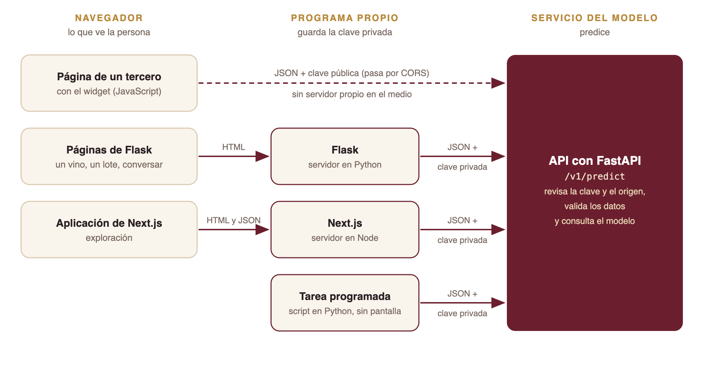
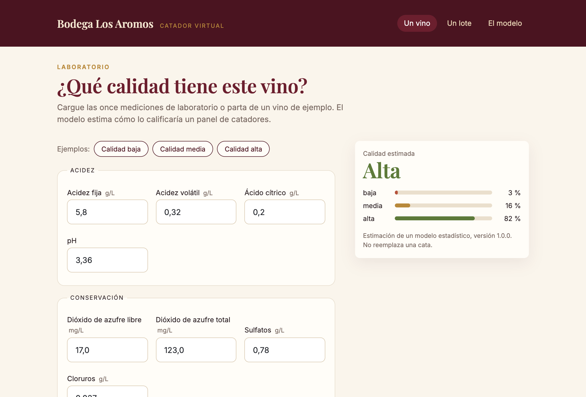
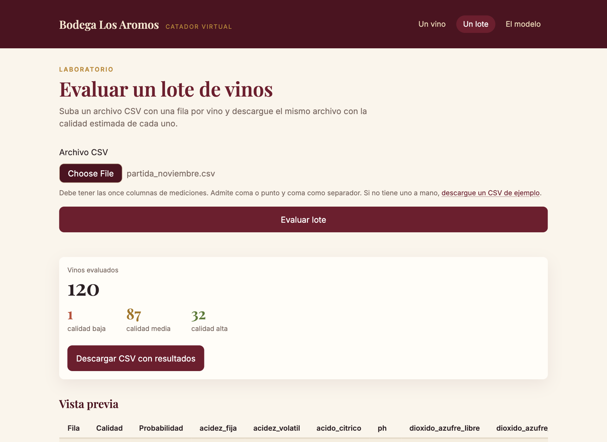
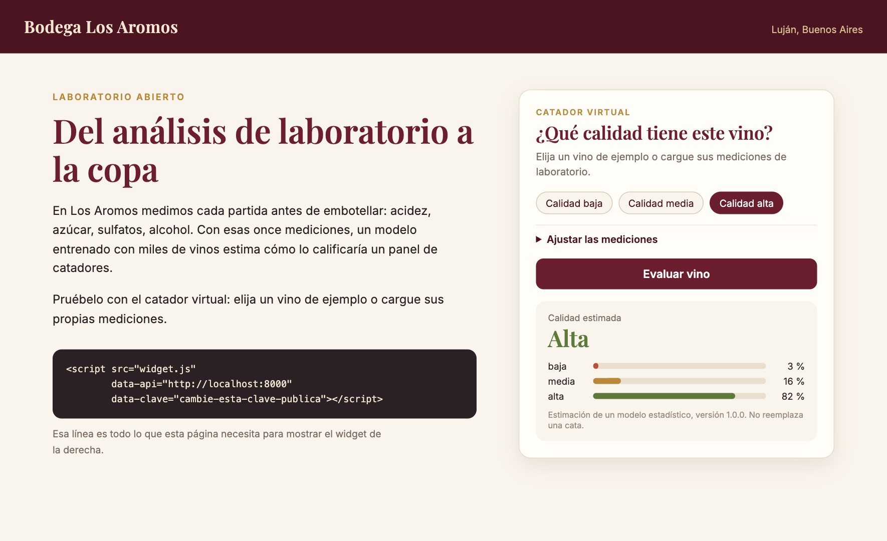
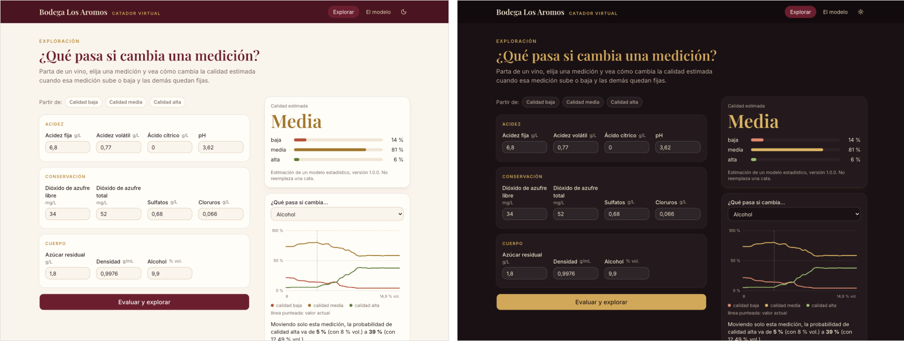
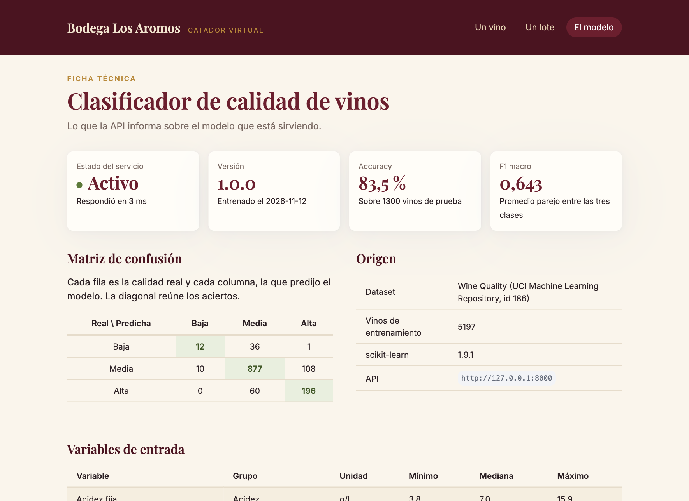
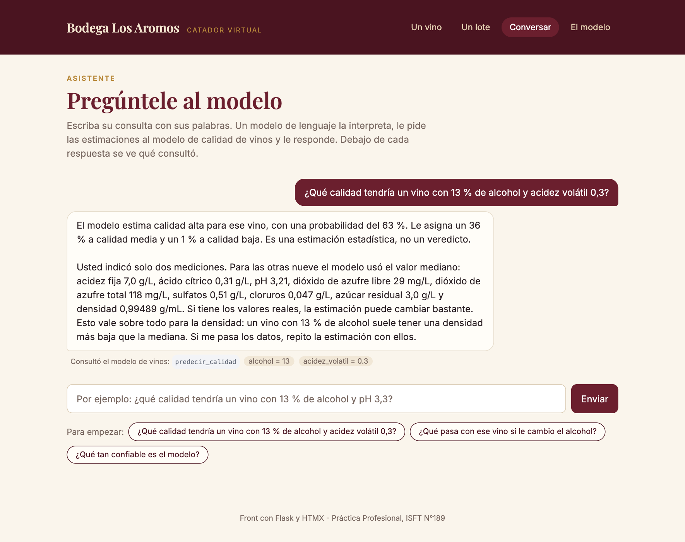

```{=typst}
#align(center)[#image("img/logo3.jpg", height: 1.9cm)]
#align(center)[#text(style: "italic", size: 10pt)[Laboratorio en Ciencia de Datos & Inteligencia Artificial \ Instituto Superior de Formación Técnica N°189]]
#line(length: 100%, stroke: 0.5pt)
#v(0.6em)
#align(center)[#text(weight: "bold", size: 12pt)[#underline[GUÍA PRÁCTICA: INTEGRACIÓN DEL MODELO Y FRONT-END]] #linebreak() #v(0.3em) #text(size: 10.5pt)[Una API con clave y CORS, siete formas de aprovechar el modelo, sus pruebas y su despliegue]]
```

::: {.content-visible when-format="html"}
```{=html}
<div style="text-align:center"><p style="font-style:italic;margin:.6em 0 0">Laboratorio en Ciencia de Datos &amp; Inteligencia Artificial<br>Instituto Superior de Formación Técnica N°189</p><hr><h1 class="title" style="text-decoration:underline">GUÍA PRÁCTICA: INTEGRACIÓN DEL MODELO Y FRONT-END</h1><p>Una API con clave y CORS, siete formas de aprovechar el modelo, sus pruebas y su despliegue</p></div>
```
:::

# Introducción

En la [Guía práctica: FastAPI](guia-fastapi.qmd) publicamos un modelo a través de una API y en la [Guía práctica: Dockerfile](guia-dockerfile.qmd) la empaquetamos en un contenedor. Con eso el modelo *responde*. Esta guía se ocupa de lo que falta para que alguien lo *aproveche*: las distintas formas de poner lo que el modelo sabe al alcance de quien lo necesita, y las precauciones mínimas de un servicio cuando sale de la computadora propia.

En el modelo de procesos CRISP-DM (clase C01) este trabajo corresponde a la fase de **Despliegue**: el modelo deja de ser un resultado de la notebook y pasa a formar parte de una solución que usa otra persona. Es también lo que pide el entregable **[04] Despliegue del modelo y presentación de la solución**: un servicio que expone el modelo, con entradas y salidas definidas, y una interfaz que lo consume y representa un caso de uso concreto.

Herramientas como Streamlit o Gradio permiten armar una pantalla en pocos minutos y sirven para un primer prototipo. En esta etapa buscamos ir un paso más allá: que la interfaz sea una aplicación web que se integra con el servicio del modelo, como las que construye un equipo de desarrollo.

El ejemplo sigue con el dataset **Wine Quality** y se ubica en una bodega ficticia, *Los Aromos*, cuyo laboratorio mide cada vino y quiere anticipar la calidad que le asignaría un panel de catadores. Sobre un mismo modelo y una misma API se desarrollan siete escenarios de uso. Las piezas son:

| Pieza | Carpeta | Qué resuelve |
|:--|:--|:----------|
| Modelo | `modelo/` | Entrena el clasificador y guarda, junto al modelo, un archivo de metadatos. |
| API | `api/` | Sirve el modelo con FastAPI. Pide una clave, limita qué sitios pueden consultarla y responde errores claros. |
| Widget | `fronts/widget/` | El modelo dentro de un sitio ajeno: un formulario que se agrega a cualquier página con una sola línea. |
| Aplicación Flask | `fronts/flask/` | La herramienta del laboratorio: consulta de un vino, evaluación de un lote desde un CSV, conversación y ficha del modelo. |
| Aplicación Next.js | `fronts/nextjs/` | Exploración: cómo cambia la calidad estimada cuando se mueve una medición. |
| Automatización | `automatizacion/` | Un script que evalúa planillas sin intervención de una persona. |
| Pruebas | `tests/` | Comprueban por HTTP que la API cumple su contrato, en su computadora o ya desplegada. |
| Documentos | `docs/` | Despliegue paso a paso, seguridad básica, errores típicos y lista de control para la presentación. |

: {tbl-colwidths="[18,20,62]"}

{width=100% fig-align="center"}

El código completo está en la carpeta [`integracion`](https://github.com/jumafernandez/eda-isft189/tree/main/integracion) del repositorio del curso. La guía muestra los fragmentos que explican cada decisión; conviene leerla con el código abierto al lado.

# Estructura y puesta en marcha

```text
integracion/
├── .env.example           # variables de configuración, para copiar como .env
├── docker-compose.yml     # levanta todo junto
├── modelo/
│   ├── datos/vinos.csv    # dataset, ya descargado
│   ├── entrenar.py        # entrena y guarda modelo.joblib y metadatos.json
│   └── metadatos.json     # variables, clases y métricas del modelo
├── api/
│   ├── app/               # código de la API, separado por responsabilidad
│   ├── requirements.txt
│   └── Dockerfile
├── fronts/
│   ├── widget/            # widget.js y una página de prueba
│   ├── flask/             # app.py, plantillas, estilos y Dockerfile
│   └── nextjs/            # aplicación con Next.js, TypeScript y shadcn/ui
├── automatizacion/        # script que evalúa planillas sin pantalla
├── tests/                 # pruebas con pytest y el script probar_api.py
└── docs/                  # despliegue, seguridad, errores y lista de control
```

## Paso 1: el archivo de configuración

Las claves y las direcciones cambian entre su computadora y la nube, y además no deben quedar escritas en el código. Por eso se guardan en **variables de entorno**: valores que el sistema operativo le entrega al programa cuando arranca. En su computadora se escriben en un archivo llamado `.env`. Desde la carpeta `integracion`:

```bash
cp .env.example .env        # en Windows: copy .env.example .env
```

Archivo `.env.example`:

```text
API_KEY=cambie-esta-clave-privada
API_KEY_PUBLICA=cambie-esta-clave-publica
ORIGENES_PERMITIDOS=http://localhost:8080
LIMITE_POR_MINUTO=30
ANTHROPIC_API_KEY=
```

La última variable es opcional: solo hace falta para el escenario conversacional, y se explica en esa sección.

::: {.callout-warning}
El archivo `.env` contiene secretos y **no se sube al repositorio**: figura en `.gitignore`. Lo que se sube es `.env.example`, con valores de muestra, para que quien clone el proyecto sepa qué variables tiene que completar.
:::

## Paso 2: levantar todo

Con Docker instalado, un solo comando construye las imágenes y levanta los servicios:

```bash
docker compose up --build
```

| Servicio | Dirección | Qué muestra |
|:--|:--|:----------|
| API | `http://localhost:8000/docs` | La documentación interactiva de la API. |
| Widget | `http://localhost:8080` | Escenario 3: la página de una bodega con el widget incorporado. |
| Flask | `http://localhost:8001` | Escenarios 1, 2, 6 y 7: un vino, un lote, la ficha del modelo y la conversación. |
| Next.js | `http://localhost:3000` | Escenario 4: exploración "¿qué pasa si...?". |

: {tbl-colwidths="[16,36,48]"}

Si prefiere trabajar sin Docker, cada pieza se levanta en una terminal distinta, con un entorno virtual activo:

```bash
pip install -r api/requirements.txt -r fronts/flask/requirements.txt
python modelo/entrenar.py                      # genera el modelo y sus metadatos

cd api && uvicorn app.main:app --reload        # terminal 1: la API
cd fronts/flask && flask run --port 8001       # terminal 2: la aplicación Flask
cd fronts/widget && python -m http.server 8080 # terminal 3: la página del widget
```

La aplicación Next.js necesita Node.js y lee sus variables de un archivo propio, `.env.local`:

```bash
cd fronts/nextjs
cp .env.example .env.local    # en Windows: copy .env.example .env.local
npm install
npm run dev                   # terminal 4: http://localhost:3000
```

El escenario sin pantalla se ejecuta aparte, con la API levantada:

```bash
pip install -r automatizacion/requirements.txt
python automatizacion/evaluar_partidas.py
```

# El modelo y sus metadatos

El modelo es el mismo de las guías anteriores, con la misma etiqueta de calidad (baja, media o alta), pero ahora usa las **once mediciones** fisicoquímicas del dataset. El archivo `modelo/datos/vinos.csv` ya está en el repositorio, con los nombres de las columnas en castellano, para que entrenar no dependa de una descarga.

Además del modelo, `entrenar.py` escribe `metadatos.json`. Este archivo es más completo que el de la guía de FastAPI, porque ahora tiene un lector nuevo: los clientes. Un fragmento:

```json
{
  "nombre": "Clasificador de calidad de vinos",
  "version": "1.0.0",
  "fecha_entrenamiento": "2026-11-12",
  "clases": ["baja", "media", "alta"],
  "variables": [
    {"nombre": "acidez_fija", "etiqueta": "Acidez fija", "unidad": "g/L",
     "grupo": "Acidez", "minimo": 3.8, "maximo": 15.9, "mediana": 7.0}
  ],
  "accuracy_prueba": 0.835,
  "f1_macro_prueba": 0.643,
  "matriz_confusion": [[12, 36, 1], [10, 877, 108], [0, 60, 196]],
  "ejemplos": [{"nombre": "Calidad alta", "valores": {"alcohol": 13.9}}]
}
```

Cada variable lleva su etiqueta, su unidad y el rango observado en los datos. Con esa información, **los formularios se arman solos**: el widget y las dos aplicaciones piden los metadatos a la API y dibujan un campo por variable. Si mañana el modelo cambia de variables, los clientes se adaptan sin tocar su código. Los `ejemplos` son tres vinos reales del conjunto de prueba, uno por clase, que los formularios ofrecen como punto de partida.

Si entrena el modelo en otra computadora o dentro de Docker, las métricas y los vinos de ejemplo pueden diferir levemente de los de este fragmento: es esperable, y por eso los clientes los leen siempre de la API en lugar de tenerlos escritos.

La **matriz de confusión** tiene una fila por clase real y una columna por clase predicha, en el orden de `clases`. La **accuracy** es la proporción de aciertos. El **F1 macro** promedia el desempeño de las tres clases dándoles el mismo peso; es más bajo que la accuracy porque los vinos de calidad baja son pocos y el modelo los reconoce con dificultad.

# La API, un paso más allá

La API de la guía de FastAPI estaba pensada para aprender. Para integrarla con aplicaciones reales cambian varias cosas:

| Aspecto | Guía de FastAPI | Esta guía |
|:--|:--|:----------|
| Rutas | `/predecir` | `/v1/predict`: todas empiezan con el número de versión. |
| Acceso | Abierto | Hay que enviar una clave en cada pedido. |
| CORS | Cualquier sitio (`*`) | Solo los sitios de una lista. |
| Errores | Formato de FastAPI, en inglés | Una sola forma para todos los errores, en castellano. |
| Configuración | Escrita en el código | Variables de entorno. |
| Código | Un archivo | Varios archivos, uno por responsabilidad. |

: {tbl-colwidths="[18,30,52]"}

El contrato completo:

| Método y ruta | Clave | Recibe | Devuelve |
|:--|:--|:--|:--------|
| `GET /v1/health` | No | Nada | El estado del servicio y la versión del modelo. |
| `GET /v1/model-info` | Sí | Nada | Los metadatos del modelo. |
| `POST /v1/predict` | Sí | Las once mediciones de un vino | La calidad y la probabilidad de cada clase. |
| `POST /v1/predict/batch` | Privada | Una lista de hasta 500 vinos | Una predicción por vino. |

: {tbl-colwidths="[30,12,28,30]"}

{width=80% fig-align="center"}

El prefijo `/v1` es una forma de **versionar** la API. Si algún día cambia el contrato (por ejemplo, una variable nueva), la versión nueva se publica en `/v2` y los clientes que usan `/v1` siguen funcionando. Los nombres de las rutas están en inglés porque es la convención más extendida en APIs públicas; los datos que viajan (`calidad`, `probabilidades`, `acidez_fija`) están en castellano.

## Organización del código

Cuando todo vivía en `api.py`, la carga del modelo, la validación y las rutas estaban mezcladas. Ahora cada archivo de `api/app/` tiene una sola responsabilidad:

| Archivo | Responsabilidad |
|:--|:----------|
| `config.py` | Lee las variables de entorno. |
| `modelo.py` | Carga el modelo y predice. No sabe nada de HTTP. |
| `esquemas.py` | Define la forma de los datos de entrada y de salida, con Pydantic. |
| `seguridad.py` | Revisa la clave y limita la cantidad de pedidos. |
| `errores.py` | Da a todos los errores la misma forma. |
| `main.py` | Crea la aplicación y define las rutas. |

: {tbl-colwidths="[22,78]"}

La separación más importante es la de `modelo.py`, que el entregable [04] valora de manera explícita: **la lógica del modelo no depende de la capa de servicio**. La función que predice recibe diccionarios y devuelve diccionarios; se puede usar y probar sin levantar la API.

```python
def predecir(vinos):
    """Recibe una lista de vinos (diccionarios) y devuelve sus predicciones."""
    tabla = pd.DataFrame(vinos)[COLUMNAS]
    clases = modelo.predict(tabla)
    probabilidades = modelo.predict_proba(tabla)

    predicciones = []
    for clase, fila in zip(clases, probabilidades):
        por_clase = {}
        for nombre, valor in zip(modelo.classes_, fila):
            por_clase[str(nombre)] = round(float(valor), 3)
        predicciones.append({"calidad": str(clase), "probabilidades": por_clase})
    return predicciones
```

La ruta, en `main.py`, queda reducida a recibir el pedido, llamar a esa función y responder:

```python
def predecir(vino: esquemas.Vino):
    """Predice la calidad de un vino."""
    prediccion = modelo.predecir([vino.model_dump()])[0]
    prediccion["version_modelo"] = VERSION_MODELO
    return prediccion
```

## Configuración por variables de entorno

`config.py` es el único lugar donde la API lee su configuración:

```python
# Clave privada: la usan los servidores (Flask, Next.js). Permite todo.
API_KEY = os.getenv("API_KEY", "")

# Clave pública: la usa el widget, que corre en el navegador y por eso
# cualquiera puede verla. Tiene límite de pedidos y no puede predecir por lote.
API_KEY_PUBLICA = os.getenv("API_KEY_PUBLICA", "")

# Sitios web autorizados a consultar la API desde el navegador (CORS)
ORIGENES_PERMITIDOS = leer_lista("ORIGENES_PERMITIDOS")
```

`os.getenv` busca la variable en el entorno. En su computadora, la librería `python-dotenv` carga antes el contenido del archivo `.env`; en la nube no hay archivo y los valores se escriben en el panel de la plataforma. El código es el mismo en los dos casos. Si falta `API_KEY`, la API no arranca y lo informa con un mensaje: es preferible fallar al inicio que publicar por descuido un servicio sin protección.

## Clave de acceso

Una **clave de API** (*API key*) es un texto secreto que el cliente envía en cada pedido para identificarse. La convención es mandarla en un **encabezado** HTTP, un dato que acompaña al pedido sin formar parte del cuerpo. Aquí el encabezado se llama `X-API-Key`.

En FastAPI, la revisión se escribe una sola vez como una **dependencia**: una función que se ejecuta antes que la ruta y puede cortar el pedido.

```python
def exigir_clave(request: Request, x_api_key: str | None = Header(default=None)):
    """Corta con 401 si falta el encabezado X-API-Key o la clave es incorrecta."""
    tipo = tipo_de_clave(x_api_key)
    if tipo is None:
        raise HTTPException(
            status_code=401,
            detail="Falta la clave o es incorrecta. "
                   "Envíela en el encabezado X-API-Key.",
        )
    if tipo == "publica":
        limitar_pedidos(request)
    return tipo
```

Cada ruta protegida la declara con `dependencies=[Depends(seguridad.exigir_clave)]`. Para probarlo desde la terminal:

```bash
curl http://localhost:8000/v1/model-info                # responde 401
curl http://localhost:8000/v1/model-info -H "X-API-Key: cambie-esta-clave-privada"
```

En la página `/docs`, el botón **Try it out** de cada ruta muestra un campo `x-api-key` para completar.

## Dos claves con permisos distintos

No todos los clientes merecen la misma confianza. Una clave que usa un servidor queda guardada en ese servidor. Una clave que usa una página web viaja al navegador de cada visitante, y cualquiera puede leerla con las herramientas de desarrollo (F12). Por eso la API maneja dos:

| Clave | Quién la usa | Qué puede hacer |
|:--|:--|:----------|
| Privada (`API_KEY`) | Los servidores de las aplicaciones Flask y Next.js, y el script de automatización. | Todo, incluida la predicción por lote. |
| Pública (`API_KEY_PUBLICA`) | El widget, desde el navegador. | Consultar los metadatos y predecir de a un vino, con un tope de pedidos por minuto. No puede predecir por lote. |

: {tbl-colwidths="[26,30,44]"}

Los códigos de respuesta distinguen los casos: **401** cuando la clave falta o es incorrecta, **403** cuando la clave es válida pero no alcanza para esa operación y **429** cuando se superó el tope de pedidos.

## CORS con una lista de orígenes

En la guía de FastAPI se explicó que el navegador bloquea los pedidos entre **orígenes** distintos salvo que el servidor los autorice, y se usó `allow_origins=["*"]`. Ahora la autorización se limita a los sitios que figuran en `ORIGENES_PERMITIDOS`:

```python
# CORS: solo los sitios de la lista pueden consultar la API desde el navegador
app.add_middleware(
    CORSMiddleware,
    allow_origins=config.ORIGENES_PERMITIDOS,
    allow_methods=["GET", "POST"],
    allow_headers=["Content-Type", "X-API-Key"],
)
```

Un origen es la combinación de protocolo, dominio y puerto, sin barra final: `http://localhost:8080` y `https://www.bodega.com` son orígenes; `https://www.bodega.com/` no coincide con el segundo.

::: {.callout-note}
CORS no reemplaza a la clave. Es una regla que aplican **los navegadores** para proteger a quien navega; `curl`, Python u otro servidor la ignoran. La clave decide *quién* puede usar la API; CORS decide *desde qué sitios web* puede hacerlo un navegador.
:::

## Errores con una sola forma

Un cliente es más simple de escribir si todos los errores llegan igual. `errores.py` convierte cualquier error en un JSON con tres campos, y traduce los mensajes de validación de Pydantic:

```text
POST /v1/predict   (con "alcohol": 45 y sin "ph")

422 Unprocessable Entity
{"error": "datos_invalidos",
 "mensaje": "Hay 2 dato(s) para corregir.",
 "detalle": [{"campo": "ph", "mensaje": "Falta este dato."},
             {"campo": "alcohol", "mensaje": "Debe ser menor o igual a 20."}]}
```

En un lote, el campo indica además la posición del vino: `vinos[3].ph`. Los errores inesperados (código **500**) se anotan completos en el registro del servidor, pero al cliente se le responde un mensaje general: los detalles internos de una falla no deben salir del servicio.

## Límite y registro de pedidos

Una clave que cualquiera puede leer necesita un freno. `seguridad.py` recuerda en qué momento hizo sus últimos pedidos cada dirección IP y, si con la clave pública se superan los 30 por minuto, responde **429**:

```python
    recientes = []
    for momento in pedidos_por_ip.get(ip, []):
        if ahora - momento < 60:
            recientes.append(momento)

    if len(recientes) >= config.LIMITE_POR_MINUTO:
        raise HTTPException(
            status_code=429,
            detail="Demasiados pedidos. Espere un minuto y vuelva a intentar.",
            headers={"Retry-After": "60"},
        )
```

Es una versión mínima: la cuenta vive en la memoria del proceso y se pierde si la API se reinicia. Los servicios con mucho tráfico delegan esta tarea en una base de datos compartida o en la propia plataforma.

Por último, la API anota cada pedido que atiende: método, ruta, código de respuesta y demora. Ese **registro** (*log*) es lo primero que se consulta cuando algo falla en un servicio desplegado. Nunca se anotan las claves.

```text
2026-11-12 10:31:07,412 INFO POST /v1/predict -> 200 (12.4 ms)
2026-11-12 10:31:09,880 INFO POST /v1/predict -> 422 (1.9 ms)
```

# Formas de aprovechar el modelo

Un mismo modelo, publicado como servicio, se puede aprovechar de maneras muy distintas. Antes de elegir una tecnología conviene responder otra pregunta: **quién necesita lo que el modelo sabe, en qué momento y para decidir qué**. De esa respuesta sale el tipo de interfaz. El ejemplo desarrolla siete escenarios sobre la misma API:

| Escenario | Quién lo usa y para qué | Qué le pide a la API | Dónde está |
|:--|:----------|:--|:--|
| 1. Consulta individual | Una persona del laboratorio quiere saber la calidad de un vino. | Una predicción | Aplicación Flask, pantalla **Un vino** |
| 2. Evaluación por lote | El laboratorio evalúa una partida completa a partir de una planilla. | Un lote de predicciones | Aplicación Flask, pantalla **Un lote** |
| 3. Dentro de un sitio ajeno | El público de otro sitio consulta sin salir de esa página. | Una predicción, con la clave pública | Widget |
| 4. Exploración | Quien elabora el vino quiere entender qué mueve la calidad: "¿qué pasa si...?". | Un lote con variantes de un mismo vino | Aplicación Next.js |
| 5. De sistema a sistema | Un programa evalúa las planillas del día sin que nadie abra una pantalla. | Un lote de predicciones | Script de `automatizacion/` |
| 6. Transparencia | Quien decide con el modelo quiere saber qué modelo es y cuánto acierta. | Los metadatos | Pantalla **El modelo** |
| 7. Conversación | Alguien que no conoce las mediciones pregunta con sus palabras. | Lo que haga falta para responder | Aplicación Flask, pantalla **Conversar** |

: {tbl-colwidths="[20,36,22,22]"}

Las tecnologías cambian de un escenario a otro (HTML y JavaScript, Python con Flask, React con Next.js, un script, un modelo de lenguaje), pero son un medio. Lo que distingue a cada escenario es **el uso que hace del modelo**, y eso es lo que su equipo tiene que definir para el entregable [04]: el caso de uso concreto.

## Quién le habla a la API

En todos los escenarios hay una decisión de arquitectura previa: **¿quién le habla a la API, el navegador o un programa propio?** De la respuesta depende dónde queda guardada la clave.

- **Directo desde el navegador.** La página trae código JavaScript que llama a la API. Es simple y no requiere ningún servidor propio, pero todo lo que llega al navegador es público, incluida la clave. Necesita CORS. Es el caso del escenario 3.
- **A través de un programa propio.** El navegador solo conversa con el servidor de la aplicación, y es ese servidor el que llama a la API con la clave privada. La clave nunca sale del servidor y no hace falta CORS, porque el pedido a la API no lo hace un navegador. A este servidor intermedio se lo suele llamar **BFF** (*backend for frontend*). Es el caso de los escenarios 1, 2, 4, 6 y 7. En el escenario 5 no hay navegador: el programa es el único cliente.

## Escenario 1: consulta individual

Es el uso más directo: una persona carga los datos de un caso y recibe la respuesta del modelo. En el ejemplo lo resuelve la pantalla **Un vino** de la aplicación hecha con **Flask**, el framework de Python ya presentado en la guía de Dockerfile. El servidor arma las páginas HTML con plantillas y es el único que conversa con la API.

{width=92% fig-align="center"}

Todos los pedidos a la API pasan por una función de `app.py`, que agrega la clave privada y convierte cualquier falla en un error propio:

```python
def llamar_api(metodo, ruta, datos=None):
    """Hace un pedido a la API con la clave privada y devuelve el JSON."""
    try:
        respuesta = requests.request(
            metodo, API_URL + ruta, json=datos,
            headers={"X-API-Key": API_KEY}, timeout=60,
        )
    except requests.RequestException:
        raise ErrorDeApi("No se pudo conectar con la API del modelo. "
                         "Verifique que esté levantada.")
```

En una aplicación web tradicional, cada envío de formulario recarga la página completa. **HTMX** es una librería pequeña que evita esa recarga sin obligar a escribir JavaScript: se agregan atributos al HTML que indican a qué ruta enviar el formulario y qué parte de la página reemplazar con la respuesta.

```html
  <form hx-post="{{ url_for('predecir') }}" hx-target="#resultado"
        hx-indicator="#evaluar" novalidate>
```

`hx-post` envía el formulario a la ruta `/predecir` de Flask. La ruta llama a la API y devuelve **un trozo de HTML**, no una página entera ni un JSON; `hx-target` indica que ese trozo reemplaza el contenido del recuadro `#resultado`.

```python
@app.route("/predecir", methods=["POST"])
def predecir():
    """Recibe el formulario y devuelve solo el recuadro del resultado."""
    # Los valores viajan como texto; la API se encarga de validarlos
    vino = request.form.to_dict()
    try:
        prediccion = llamar_api("POST", "/v1/predict", vino)
    except ErrorDeApi as error:
        return render_template("_error.html", error=error)
    return render_template("_resultado.html", prediccion=prediccion)
```

El formulario no valida los valores en el navegador: los envía tal como están y muestra los errores que devuelve la API. Validar en el cliente mejora la experiencia de uso, pero **la validación que cuenta es la del servidor**, porque es la única que no se puede saltear.

## Escenario 2: evaluación por lote

Cuando hay que evaluar cientos de casos, cargarlos de a uno no es una opción. La pantalla **Un lote** de la misma aplicación recibe un archivo CSV con una fila por vino y devuelve el mismo archivo con la calidad estimada de cada uno, además de un resumen. Es la forma de uso que más se parece al trabajo real de un laboratorio, que ya tiene sus mediciones en una planilla.

{width=80% fig-align="center"}

Para eso existe la ruta `/v1/predict/batch`, que recibe hasta 500 vinos por pedido. Flask reparte el archivo en tandas de ese tamaño:

```python
def predecir_por_tandas(vinos):
    """Envía los vinos a la API en tandas, respetando su tope por pedido."""
    predicciones = []
    for desde in range(0, len(vinos), MAXIMO_POR_LOTE):
        tanda = vinos[desde:desde + MAXIMO_POR_LOTE]
        try:
            respuesta = llamar_api("POST", "/v1/predict/batch", {"vinos": tanda})
        except ErrorDeApi as error:
            raise ErrorDeApi(error.mensaje, ubicar_en_archivo(error.detalle, desde))
        predicciones.extend(respuesta["predicciones"])
    return predicciones
```

Dos detalles pensados para quien usa la pantalla: acepta coma o punto y coma como separador, porque así exporta las planillas Excel cuando está configurado en castellano, y si un dato es inválido el error indica la fila de la planilla (`fila 5, ph`) en lugar de la posición interna que informa la API.

## Escenario 3: el modelo dentro de un sitio ajeno

A veces el modelo tiene que ir a donde ya está el público, en lugar de pedirle que entre a una aplicación nueva. Un **widget** es un componente que un tercero agrega a su sitio sin conocer cómo funciona, como el mapa o el reproductor de video que se ven en tantas páginas. El de este ejemplo se incorpora con una sola línea de HTML:

```html
<script src="widget.js"
  data-api="http://localhost:8000"
  data-clave="cambie-esta-clave-publica"></script>
```

{width=92% fig-align="center"}

El archivo `widget.js` no usa ningún framework. Al cargarse hace cuatro cosas:

1. Lee la dirección de la API y la clave de los atributos `data-api` y `data-clave` de su propia etiqueta.
2. Crea un recuadro en el lugar donde está la etiqueta y lo aísla con **Shadow DOM**, una función del navegador que impide que los estilos del widget alteren la página que lo aloja, y viceversa.
3. Pide los metadatos a `GET /v1/model-info` y arma el formulario con ellos.
4. Al presionar **Evaluar vino**, envía los valores a `POST /v1/predict` y dibuja el resultado.

Toda la comunicación pasa por una función que agrega la clave y traduce los errores a mensajes para la persona:

```javascript
  async function pedir(ruta, opciones) {
    let respuesta;
    try {
      respuesta = await fetch(API + ruta, {
        ...opciones,
        headers: { "Content-Type": "application/json", "X-API-Key": CLAVE },
      });
    } catch (falla) {
      // fetch falla sin respuesta cuando el servicio está caído o cuando
      // este sitio no figura en la lista de CORS de la API
      throw new Error("No se pudo conectar con el servicio. Intente más tarde.");
    }
```

En este escenario el navegador le habla directo a la API, y por eso es el único que necesita las dos precauciones de la sección anterior: que el origen del sitio figure en `ORIGENES_PERMITIDOS` y que la clave escrita en `data-clave` sea la **pública**, con permisos mínimos.

## Escenario 4: exploración

Un modelo no solo sirve para dar un veredicto: también permite hacerle preguntas. ¿Qué pasaría con este vino si tuviera más alcohol? ¿Cuánto pesa la acidez volátil? En este escenario la persona parte de un vino, elige una medición y ve cómo cambia la calidad estimada cuando esa medición recorre su rango y las demás quedan fijas.

{width=100% fig-align="center"}

La pantalla necesita mucha interacción (elegir, mover, redibujar), y por eso está hecha con **Next.js**, un framework para construir aplicaciones web con React, la librería de JavaScript más usada para armar interfaces. Está escrita en **TypeScript**, una variante de JavaScript en la que se declara el tipo de cada dato, de modo que muchos errores se detectan antes de ejecutar el programa.

La arquitectura es la misma que en Flask: el navegador le habla al servidor de la aplicación, y el servidor le habla a la API. El navegador envía el vino y el nombre de la medición a una ruta del propio sitio, un **Route Handler**: una función del servidor de Next.js que responde a un método y una dirección, igual que una ruta de FastAPI o de Flask. Esa función arma 41 copias del vino en las que solo cambia la medición elegida y pide todas las predicciones en un solo lote:

```typescript
    // Valores parejos entre el mínimo y el máximo observados en los datos
    const valores: number[] = [];
    for (let paso = 0; paso <= PUNTOS; paso++) {
      const avance = paso / PUNTOS;
      valores.push(rango.minimo + (rango.maximo - rango.minimo) * avance);
    }
    const variantes: Vino[] = valores.map((valor) => ({
      ...vino,
      [variable]: valor,
    }));

    // Un solo pedido por lote: primero el vino original, después sus variantes
    const lote = await predecirLote([vino, ...variantes]);
    const [original, ...resto] = lote.predicciones;
```

Con esas predicciones el navegador dibuja una curva por clase. El escenario muestra además por qué conviene tener un servidor propio en el medio: la exploración usa la predicción por lote, que la clave pública no tiene permitida.

::: {.callout-warning}
La curva describe **cómo responde el modelo**, no una relación de causa y efecto. En un vino real no se puede subir el alcohol y dejar todo lo demás igual: las mediciones cambian juntas. La exploración sirve para entender al modelo y para formular preguntas, no para prometer el resultado de una intervención.
:::

El cliente de la API vive en `lib/api.ts`, un archivo que solo puede correr en el servidor:

```typescript
import "server-only";

import type { ErrorDeApi, InfoModelo, RespuestaLote, Vino } from "./tipos";

const API_URL = process.env.API_URL ?? "http://localhost:8000";
const API_KEY = process.env.API_KEY ?? "";
```

La primera línea es una protección: si alguien importa ese archivo desde un componente del navegador, la compilación falla. Así la clave no puede terminar por error en el código que recibe el público.

Este cliente suma dos prácticas que conviene conocer:

- **Tipos generados desde la API.** FastAPI publica la descripción de su contrato en `/openapi.json`. El comando `npm run tipos` la lee y escribe `lib/api-tipos.ts`, con el tipo de cada dato de entrada y de salida. Si la API renombra un campo, TypeScript señala cada lugar del front que hay que ajustar, sin esperar a que falle en uso.
- **Validación compartida.** Las reglas se escriben una vez, con la librería `zod`, y se usan dos veces: en el navegador, para avisar del error apenas se escribe, y en el Route Handler, antes de llamar a la API.

```typescript
function medicion(minimo: number, maximo: number) {
  return z
    .number({ error: "Debe ser un número." })
    .min(minimo, `Debe ser mayor o igual a ${minimo}.`)
    .max(maximo, `Debe ser menor o igual a ${maximo}.`);
}
```

Los componentes visuales (botones, tarjetas, tablas) son de **shadcn/ui**, una colección que se copia dentro del proyecto, en `components/ui/`, y se ajusta con las clases de Tailwind. La curva es un dibujo SVG hecho a mano, sin ninguna librería de gráficos.

## Escenario 5: de sistema a sistema

En muchos casos el mejor uso de un modelo no tiene pantalla. Un programa lo consulta por su cuenta, a una hora fija o cada vez que llegan datos nuevos, y deja el resultado donde otro sistema o una persona lo va a encontrar. Es lo que en la clase de APIs hicimos como consumidores de servicios de terceros, ahora contra nuestro propio servicio.

El script `automatizacion/evaluar_partidas.py` simula la tarea diaria del laboratorio: toma cada planilla de la carpeta `entrada/`, le pide las predicciones a la API y deja en `salida/` la misma planilla con una columna más.

```text
$ python automatizacion/evaluar_partidas.py
Modelo Clasificador de calidad de vinos, versión 1.0.0
  partida_ejemplo.csv: 120 vinos (1 baja, 87 media, 32 alta)
Resultados en .../integracion/automatizacion/salida
```

Un programa pensado para correr solo tiene dos obligaciones que una pantalla no tiene: no preguntar nada y avisar con claridad cuando falla. Por eso el script termina con un **código de salida** distinto de cero ante cualquier error, que es la señal que entienden las herramientas que ejecutan tareas programadas (el Programador de tareas de Windows, `cron` en Linux o un flujo de n8n).

```python
    for planilla in planillas:
        conteo = evaluar(planilla, columnas, info["clases"])
        partes = [f"{cantidad} {clase}" for clase, cantidad in conteo.items()]
        total = sum(conteo.values())
        print(f"  {planilla.name}: {total} vinos ({', '.join(partes)})")
except (requests.RequestException, RuntimeError, KeyError) as error:
    print(f"No se pudo completar la evaluación: {error}", file=sys.stderr)
    sys.exit(1)
```

Las pruebas automáticas de la sección siguiente son otro ejemplo de este escenario: un programa que usa la API sin intervención humana.

## Escenario 6: transparencia

Quien toma una decisión apoyándose en un modelo necesita saber qué modelo le está respondiendo, con qué datos se entrenó y cuánto acierta. La ruta `/v1/model-info` existe para eso, y las dos aplicaciones tienen una pantalla **El modelo** que la muestra: versión, fecha de entrenamiento, métricas, matriz de confusión y variables de entrada. La de Flask informa además el estado del servicio, que consulta en `/v1/health`.

{width=80% fig-align="center"}

Esta pantalla no tiene ningún dato escrito a mano: si se reentrena el modelo, la ficha cambia sola. Publicar las métricas junto con las predicciones es también una forma de usar el modelo con responsabilidad: en este caso deja a la vista que reconoce con dificultad los vinos de calidad baja.

## Escenario 7: conversación

Los modelos de lenguaje abrieron otra forma de llegar a un modelo: preguntarle con palabras propias, sin formulario. "¿Qué calidad tendría un vino con 13 % de alcohol?", "¿y si le bajo la acidez?", "¿qué tan confiable es eso?". Es una interfaz útil para quien no conoce las once mediciones ni quiere aprender una pantalla nueva, y es una de las opciones que admite el entregable [04].

En este escenario intervienen **dos modelos distintos**, y conviene no confundirlos:

- El **modelo de lenguaje** (aquí Claude, de Anthropic) entiende la pregunta y redacta la respuesta. No sabe nada sobre la calidad de los vinos de la bodega.
- El **modelo de calidad de vinos**, el de toda la guía, es el único que estima calidades.

Lo que los conecta es el **uso de herramientas** (*tool use* o *function calling*). Al modelo de lenguaje se le describen funciones que puede pedir que se ejecuten. El ida y vuelta es este:

1. La aplicación envía al modelo de lenguaje la pregunta de la persona, junto con la descripción de las herramientas.
2. El modelo de lenguaje no responde todavía: pide que se ejecute una herramienta, con ciertos datos.
3. La aplicación ejecuta esa función, que consulta la API del modelo de vinos, y le devuelve el resultado.
4. Con el resultado, el modelo de lenguaje redacta la respuesta. Si necesita más datos, repite los pasos 2 y 3.

Una herramienta es una función común de Python. El decorador `@beta_tool`, de la librería `anthropic`, arma su descripción a partir del nombre, los tipos de los parámetros y el texto de documentación, que es lo que el modelo de lenguaje lee para decidir cuándo usarla:

```python
@beta_tool
def predecir_calidad(mediciones: dict[str, float]) -> str:
    """Estima la calidad de un vino (baja, media o alta) con el modelo de la bodega.

    Args:
        mediciones: Mediciones conocidas del vino, por nombre de variable, por
            ejemplo {"alcohol": 12.5, "ph": 3.2}. Las que falten se completan
            con la mediana y se informan en "mediciones_supuestas".
    """
    try:
        info = llamar_api("GET", "/v1/model-info")
        vino, supuestas = completar(mediciones, info)
        prediccion = llamar_api("POST", "/v1/predict", vino)
    except ErrorDeApi as error:
        return como_texto({"error": error.mensaje, "detalle": error.detalle})
    prediccion["mediciones_supuestas"] = supuestas
    return como_texto(prediccion)
```

La función usa el mismo `llamar_api` de los escenarios 1 y 2: para la API del modelo de vinos, el chat es un cliente más. Hay una segunda herramienta, `explorar_medicion`, que resuelve por lote la pregunta "¿qué pasa si...?" del escenario 4.

El ida y vuelta de los cuatro pasos lo maneja la propia librería:

```python
    conversacion = cliente.beta.messages.tool_runner(
        model=MODELO_DE_LENGUAJE,
        max_tokens=16000,
        system=armar_instrucciones(info),
        tools=HERRAMIENTAS,
        messages=historial + [{"role": "user", "content": mensaje}],
        output_config={"effort": "low"},  # preguntas simples: respuesta ágil
        max_iterations=6,
```

`system` son las **instrucciones** que recibe el modelo de lenguaje: quién es, que no debe estimar calidades por su cuenta y cómo presentar los resultados. Incluyen la ficha del modelo, tomada de `/v1/model-info`, para que conozca los nombres de las mediciones y pueda responder preguntas sobre la confiabilidad. `messages` lleva la conversación completa, porque el servicio no recuerda los mensajes anteriores: la pantalla los guarda y los reenvía en cada pedido.

{width=92% fig-align="center"}

Debajo de cada respuesta, la pantalla muestra qué herramienta se usó y con qué datos. Es una decisión de diseño: los números provienen del modelo de vinos y la redacción, del modelo de lenguaje; mostrar la consulta permite comprobar que la pregunta se interpretó bien.

::: {.callout-warning}
Este escenario depende de un servicio externo y pago. Antes de adoptarlo, tenga en cuenta tres cosas. **Cuesta dinero**: cada mensaje es una llamada que se factura. **Los datos salen de su entorno**: lo que la persona escribe viaja al proveedor del modelo de lenguaje, así que no debe incluir datos personales ni reservados. **Puede interpretar mal**: por eso las estimaciones salen siempre del modelo de vinos y la pantalla deja a la vista qué se consultó.
:::

La pantalla es opcional. Se activa escribiendo la clave del proveedor en la variable `ANTHROPIC_API_KEY` del archivo `.env`; sin ella, el resto de la aplicación funciona igual.

## Cómo elegir

| Escenario | Tipo de interfaz | Quién llama a la API | Clave | Tecnología del ejemplo |
|:--|:--|:--|:--|:--|
| 1. Consulta individual | Formulario web | El servidor de la aplicación | Privada | Flask y HTMX |
| 2. Evaluación por lote | Carga y descarga de archivos | El servidor de la aplicación | Privada | Flask y HTMX |
| 3. Dentro de un sitio ajeno | Componente embebido | El navegador | Pública | HTML y JavaScript |
| 4. Exploración | Pantalla interactiva con gráfico | El servidor de la aplicación | Privada | Next.js y React |
| 5. De sistema a sistema | Ninguna: un programa | El propio programa | Privada | Script en Python |
| 6. Transparencia | Ficha de solo lectura | El servidor de la aplicación | Privada | Flask o Next.js |
| 7. Conversación | Chat | El servidor, cuando lo pide el modelo de lenguaje | Privada | Flask y la API de Claude |

: {tbl-colwidths="[22,22,22,12,22]"}

Para el entregable [04] alcanza con resolver bien un escenario, el que corresponda al caso de uso de su proyecto, con la tecnología que el equipo maneje mejor. Lo que importa es poder explicar las decisiones: qué forma de uso se eligió, quién llama a la API, dónde queda la clave y por qué.

# Probar la integración

Probar a mano desde `/docs` sirve mientras se desarrolla, pero no alcanza para asegurar que el servicio sigue cumpliendo su contrato después de cada cambio. Las **pruebas automáticas** son programas que hacen pedidos y comprueban las respuestas. Las de `tests/` usan `pytest`, una herramienta para escribir y correr pruebas, y `httpx`, una librería para hacer pedidos HTTP.

Estas pruebas no importan el código de la API: le hablan por HTTP, como cualquier cliente. Por eso sirven igual para la API de su computadora y para la desplegada; alcanza con cambiar la variable `BASE_URL`.

```bash
pip install -r tests/requirements.txt
pytest tests -v                                        # contra la API local
BASE_URL=https://mi-api.onrender.com pytest tests -v   # contra la desplegada
```

| Qué se comprueba | Resultado esperado |
|:--|:----------|
| `/v1/health` sin clave | 200 y `"estado": "ok"`. |
| `/v1/model-info` | 200, con once variables, tres clases, métricas y matriz de 3 x 3. |
| Predicción válida | 200, una de las tres clases y probabilidades que suman 1. |
| Los tres vinos de ejemplo | La API devuelve para cada uno la clase esperada: es el modelo que se entrenó. |
| Valor fuera de rango, dato faltante o texto en lugar de número | 422, con el nombre del campo. |
| Lote de tres vinos | 200 y tres predicciones. |
| Lote vacío o de más de 500 vinos | 422. |
| Pedido sin clave o con clave incorrecta | 401. |
| Lote con la clave pública | 403. |
| CORS desde un origen de la lista y desde uno ajeno | Solo el primero recibe la autorización. |
| Latencia de 30 predicciones | Promedio y percentil 95 por debajo de un máximo. |

: {tbl-colwidths="[46,54]"}

Una prueba se lee casi como una oración:

```python
def test_valor_fuera_de_rango_devuelve_422(cliente, vino):
    vino["alcohol"] = 45
    respuesta = cliente.post("/v1/predict", json=vino)
    assert respuesta.status_code == 422

    error = respuesta.json()
    assert error["error"] == "datos_invalidos"
    assert error["detalle"][0]["campo"] == "alcohol"
```

La **latencia** es el tiempo que tarda la API en responder. El promedio solo no alcanza para describirla: si 29 pedidos tardan 20 ms y uno tarda 3 segundos, el promedio parece aceptable y esconde una mala experiencia. Por eso se mide también el **percentil 95** (p95): el tiempo por debajo del cual quedó el 95 % de los pedidos.

Para una revisión rápida, sin instalar `pytest`, el script `probar_api.py` recorre los casos principales e informa el resultado de cada uno:

```text
$ python tests/probar_api.py https://mi-api.onrender.com

  [OK   ] La API responde en /v1/health (0.4 s)
  [OK   ] Devuelve los metadatos del modelo
  [OK   ] Predice un vino válido
  [OK   ] Rechaza un valor fuera de rango con 422
  [OK   ] Predice un lote de 5 vinos
  [OK   ] Rechaza un pedido sin clave con 401
  [OK   ] No autoriza por CORS a un sitio ajeno
  [OK   ] Responde en menos de un segundo en promedio

8 de 8 revisiones correctas
```

El repositorio incluye además un flujo de **integración continua** (`.github/workflows/pruebas-integracion.yml`): cada vez que se sube un cambio a la carpeta `integracion`, GitHub entrena el modelo, levanta la API y corre todas las pruebas. Si alguna falla, el cambio queda marcado antes de llegar a quienes usan el servicio.

# Desplegar

Mientras la API corre en `localhost`, solo se puede usar desde su computadora. **Desplegar** es ponerla en una máquina encendida de manera permanente y con una dirección pública. Hay dos caminos, que retoman la comparación entre infraestructura propia y nube de la clase C03:

| | Plataforma administrada | Servidor propio |
|:--|:--|:--|
| Ejemplos | Render, Vercel | Una máquina virtual con Docker Compose y nginx |
| Qué se entrega | El repositorio; la plataforma construye y publica | Los contenedores, que uno mismo instala y mantiene |
| HTTPS y dominio | Incluidos | Hay que configurarlos |
| Costo | Plan gratuito con límites | El de la máquina, use o no el servicio |
| Mantenimiento | A cargo de la plataforma | A cargo propio: actualizaciones, reinicios, copias |
| Control | Limitado a lo que ofrece la plataforma | Total |

: {tbl-colwidths="[22,39,39]"}

Para el entregable [04] alcanza con que la solución funcione de manera local; el despliegue en un entorno accesible se valora, pero no es obligatorio. Si su equipo decide desplegar, el camino más corto es una plataforma administrada:

1. Suba el proyecto a un repositorio de GitHub, sin el archivo `.env`.
2. Cree en la plataforma un servicio web a partir del repositorio e indique dónde está el `Dockerfile`.
3. Cargue las variables de entorno en el panel de la plataforma, con claves nuevas y distintas de las de desarrollo.
4. Indique `/v1/health` como ruta de control: la plataforma la consulta para saber si el servicio está activo.
5. Corra `probar_api.py` contra la dirección pública.

El paso a paso con Render y con Vercel está en [`docs/despliegue.md`](https://github.com/jumafernandez/eda-isft189/blob/main/integracion/docs/despliegue.md), y la variante en un servidor propio, en [`docs/servidor-propio.md`](https://github.com/jumafernandez/eda-isft189/blob/main/integracion/docs/servidor-propio.md).

| Servicio | Variables que necesita |
|:--|:----------|
| API | `API_KEY`, `API_KEY_PUBLICA`, `ORIGENES_PERMITIDOS` (con la dirección pública del sitio que aloja el widget). |
| Aplicación Flask | `API_URL` (la dirección pública de la API) y `API_KEY`. Opcional: `ANTHROPIC_API_KEY`. |
| Aplicación Next.js | `API_URL` y `API_KEY`, las mismas que Flask. |
| Widget | Ninguna: la dirección de la API y la clave pública van en los atributos de la etiqueta `<script>`. |

: {tbl-colwidths="[24,76]"}

::: {.callout-note}
En los planes gratuitos, la plataforma apaga los servicios que pasan un rato sin recibir pedidos. El primer pedido posterior tarda cerca de un minuto, porque tiene que volver a encenderlos. Téngalo en cuenta antes de una demostración: abra la aplicación unos minutos antes.
:::

# Seguridad básica

Las decisiones de esta guía se resumen en una lista que conviene revisar antes de publicar cualquier servicio. El detalle de cada punto está en [`docs/seguridad.md`](https://github.com/jumafernandez/eda-isft189/blob/main/integracion/docs/seguridad.md).

- Las claves viven en variables de entorno; el archivo `.env` no se sube al repositorio.
- Las claves de producción son distintas de las de desarrollo y se pueden cambiar sin tocar el código.
- La clave privada nunca llega al navegador: solo la usan los servidores de Flask y de Next.js y el script de automatización. Lo mismo vale para la clave del modelo de lenguaje. Lo que el navegador necesita usa una clave pública con permisos mínimos y tope de pedidos.
- CORS autoriza una lista de orígenes, no `*`.
- Todos los datos de entrada se validan en el servidor.
- Los errores no revelan detalles internos y el registro no guarda claves.
- El contenedor corre con un usuario sin privilegios.
- El servicio desplegado se usa siempre por HTTPS.

# Errores frecuentes

| Problema | Causa y solución |
|:--|:--------|
| La API no arranca: `Falta la variable de entorno API_KEY` | No existe el archivo `.env` o está en otra carpeta. Copie `.env.example` como `.env` dentro de `integracion`. |
| Respuesta `401` aunque se envía la clave | El encabezado tiene otro nombre o la clave no coincide con la del `.env`. Si cambió el `.env`, reinicie la API: las variables se leen al arrancar. |
| Respuesta `403` al predecir por lote | Se está usando la clave pública. El lote necesita la privada. |
| El widget muestra "No se pudo conectar con el servicio" y la consola (F12) indica un error de CORS | El origen de la página no figura en `ORIGENES_PERMITIDOS`, o figura con una barra final o con otro puerto. |
| El widget funciona en `localhost` pero no una vez publicado | La API sigue autorizando solo `http://localhost:8080`. Agregue el origen público a `ORIGENES_PERMITIDOS` y actualice `data-api`. |
| Flask muestra "No se pudo conectar con la API del modelo" dentro de Compose | `API_URL` apunta a `localhost`. Entre contenedores, la API se encuentra por el nombre del servicio: `http://api:8000`. |
| Next.js muestra "No pudimos consultar el modelo" | Falta el archivo `fronts/nextjs/.env.local`, o su `API_KEY` no coincide con la de la API. Después de cambiarlo, reinicie `npm run dev`. |
| La pantalla **Conversar** indica que el escenario no está activo | Falta `ANTHROPIC_API_KEY` en el archivo `.env`. Después de agregarla, vuelva a levantar la aplicación Flask. |
| Respuesta `429` | Se superó el tope de pedidos de la clave pública. Espere un minuto. |
| `port is already allocated` o `Address already in use` | Otro programa usa ese puerto. Ciérrelo, o cambie el número de la izquierda en `ports` del `docker-compose.yml` (por ejemplo `"8010:8000"`). |
| La carga del CSV indica que faltan columnas | Los nombres del encabezado no coinciden con los de las variables. Descargue el CSV de ejemplo desde la pantalla **Un lote** y úselo como modelo. |
| El primer pedido al servicio desplegado tarda cerca de un minuto | El plan gratuito apagó el servicio por falta de uso. Los pedidos siguientes responden normalmente. |

: {tbl-colwidths="[40,60]"}

# Lista de control para la presentación

La lista completa, para imprimir, está en [`docs/lista-de-control.md`](https://github.com/jumafernandez/eda-isft189/blob/main/integracion/docs/lista-de-control.md). Se organiza en tres niveles y un bloque sobre la exposición.

**Lo que pide el entregable [04]**

- Un servicio que expone el modelo, con entradas y salidas definidas, funcionando de manera local.
- Una interfaz que consume ese servicio y representa un caso de uso concreto del proyecto.

**Lo que se valora**

- Código organizado, con la lógica del modelo separada de la capa de servicio.
- Manejo de errores: qué ve la persona cuando carga un dato inválido o el servicio no responde.
- Interfaz que consume el modelo a través de la API, sin cargar el archivo del modelo por su cuenta.
- Despliegue en un entorno accesible desde otra computadora.

**Lo que va más allá de la consigna**

- Clave de acceso y CORS con lista de orígenes.
- Pruebas automáticas e integración continua.
- Más de una forma de uso del modelo: por lote, exploración, automatización, conversación o ficha del modelo.

**La presentación del 19/11**

- Dura entre 7 y 10 minutos e incluye una demostración en vivo.
- Conviene ensayar la demostración completa en la computadora y la red que se van a usar.
- Si la solución está desplegada en un plan gratuito, hay que abrirla unos minutos antes para que el servicio esté encendido.
- Es prudente llevar capturas de pantalla o un video corto por si falla la conexión.

# Consignas

1. Reproduzca el ejemplo completo: copie `.env.example` como `.env`, levante los servicios y recorra los escenarios. El séptimo es opcional, porque necesita una clave propia.
2. Para cada escenario, anote quién sería el usuario en su proyecto y qué decisión tomaría con la respuesta del modelo. Descarte los que no apliquen y justifique por qué.
3. En el escenario de exploración, elija un vino de ejemplo y recorra tres mediciones. ¿Cuál mueve más la calidad estimada? ¿Coincide con lo que mostraban los datos en las etapas anteriores del proyecto?
4. Abra la página del widget con las herramientas de desarrollo del navegador (F12) y ubique, en la pestaña **Red**, el pedido a `/v1/predict`. ¿Qué clave viaja? Haga lo mismo en las aplicaciones Flask y Next.js: ¿aparece alguna clave?
5. Quite `http://localhost:8080` de `ORIGENES_PERMITIDOS`, reinicie la API y describa qué ocurre con el widget y qué ocurre con las aplicaciones Flask y Next.js. Explique la diferencia.
6. Corra las pruebas contra su API local. Después cambie un rango en `esquemas.py`, vuelva a correrlas y observe cuál falla y qué informa.
7. Adapte el ejemplo a su proyecto:
    a. Defina el caso de uso: quién usa la solución, en qué momento y para decidir qué.
    b. Elija el escenario que mejor lo representa y el tipo de interfaz que le corresponde.
    c. Agregue a su archivo de metadatos lo que la interfaz necesite.
    d. Decida quién llama a su API, el navegador o un programa propio, y justifique la decisión.
    e. Construya la interfaz y escriba al menos tres pruebas del contrato de su API.
8. Complete la lista de control con el estado de su proyecto antes de la presentación.

Podrá ayudarse con Modelos de Lenguaje, como Gemini y soluciones basadas en GPT, para adaptar el código a su proyecto.

# Referencias

- Chapman, P. et al. (2000). *CRISP-DM 1.0: Step-by-step data mining guide*. SPSS.
- Cortez, P., Cerdeira, A., Almeida, F., Matos, T. y Reis, J. (2009). *Wine Quality* \[Dataset\]. UCI Machine Learning Repository. <https://doi.org/10.24432/C56S3T>
- FastAPI. *Security* y *Bigger Applications - Multiple Files*. <https://fastapi.tiangolo.com/tutorial/>
- Flask. *Flask documentation*. <https://flask.palletsprojects.com/>
- HTMX. *htmx documentation*. <https://htmx.org/docs/>
- MDN Web Docs. *Cross-Origin Resource Sharing (CORS)*. <https://developer.mozilla.org/es/docs/Web/HTTP/Guides/CORS>
- MDN Web Docs. *Using shadow DOM*. <https://developer.mozilla.org/en-US/docs/Web/API/Web_components/Using_shadow_DOM>
- Anthropic. *Tool use with Claude*. <https://platform.claude.com/docs/en/agents-and-tools/tool-use/overview>
- Next.js. *Route Handlers* y *Backend for Frontend*. <https://nextjs.org/docs/app/guides/backend-for-frontend>
- OWASP. *API Security Top 10*. <https://owasp.org/API-Security/>
- pytest. *pytest documentation*. <https://docs.pytest.org/>
- shadcn/ui. *Documentation*. <https://ui.shadcn.com/docs>
- Render. *Deploy a FastAPI App*. <https://render.com/docs/deploy-fastapi>
