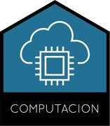

```{=html}
<div style="text-align:center"> &nbsp;&nbsp;&nbsp;  &nbsp;&nbsp;&nbsp; <p style="font-style:italic;margin:.6em 0 0">Laboratorio en Ciencia de Datos &amp; Inteligencia Artificial<br>Instituto Superior de Formación Técnica N°189</p><hr></div>
```

# Práctica Profesional: Análisis y Exploración de Datos

Material de la cursada.

## Guías

- [Guía práctica: Dockerfile](guia-dockerfile.qmd). Del modelo entrenado a la API en un contenedor. También disponible en [PDF](guia-dockerfile.pdf).
- [Código de ejemplo](https://github.com/jumafernandez/eda-isft189/tree/main/proyecto): API con FastAPI, interfaz con Streamlit y Docker Compose.
