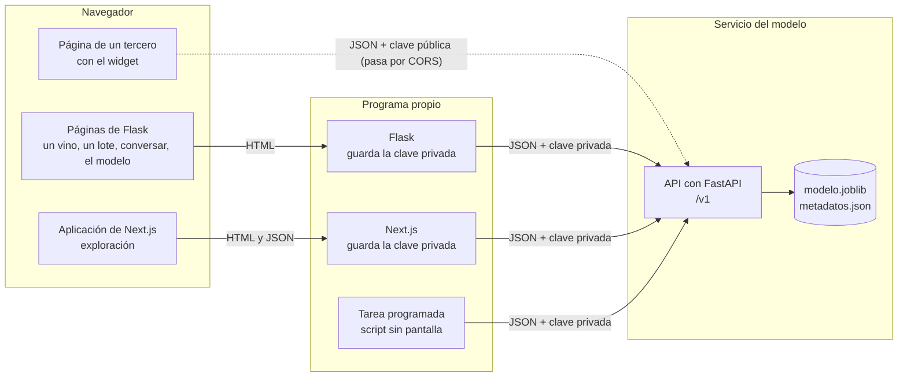

# Integración del modelo y front-end

Ejemplo de la [Guía práctica: integración del modelo y front-end](https://jumafernandez.github.io/eda-isft189/guia-integracion.html). Un mismo modelo (calidad de vinos, dataset Wine Quality) se sirve con una API y se aprovecha de siete formas distintas.

El contexto: el laboratorio de una bodega ficticia, *Los Aromos*, mide cada vino y quiere anticipar la calidad que le asignaría un panel de catadores.

## Escenarios

Lo que distingue a cada escenario es el uso que hace del modelo. La tecnología es un medio.

| Escenario | Quién lo usa y para qué | Dónde está | Tecnología |
|:--|:--|:--|:--|
| 1. Consulta individual | Una persona del laboratorio quiere saber la calidad de un vino. | `fronts/flask/`, pantalla **Un vino** | Flask y HTMX |
| 2. Evaluación por lote | El laboratorio evalúa una partida completa desde una planilla CSV. | `fronts/flask/`, pantalla **Un lote** | Flask y HTMX |
| 3. Dentro de un sitio ajeno | El público de otro sitio consulta sin salir de esa página. | `fronts/widget/` | HTML y JavaScript |
| 4. Exploración | Quien elabora el vino quiere entender qué mueve la calidad: "¿qué pasa si...?". | `fronts/nextjs/` | Next.js y React |
| 5. De sistema a sistema | Un programa evalúa las planillas del día sin que nadie abra una pantalla. | `automatizacion/` | Script en Python |
| 6. Transparencia | Quien decide con el modelo quiere saber qué modelo es y cuánto acierta. | Pantalla **El modelo** de Flask y de Next.js | Flask o Next.js |
| 7. Conversación | Alguien que no conoce las mediciones pregunta con sus palabras. Un modelo de lenguaje interpreta la pregunta y usa el modelo de vinos como herramienta. | `fronts/flask/`, pantalla **Conversar** | Flask y la API de Claude |

## Arquitectura



Hay dos caminos para llegar a la API. El widget la llama directo desde el navegador: usa una clave pública, con permisos mínimos, y necesita que la API lo autorice por CORS. Las aplicaciones Flask y Next.js y el script la llaman desde un programa propio: usan la clave privada, que nunca llega al navegador, y no necesitan CORS.

## Qué hay en cada carpeta

| Carpeta | Contenido |
|:--|:--|
| `modelo/` | `entrenar.py` entrena el clasificador y guarda `modelo.joblib` y `metadatos.json`. El dataset está en `datos/vinos.csv`. |
| `api/` | API con FastAPI: rutas `/v1/health`, `/v1/model-info`, `/v1/predict` y `/v1/predict/batch`. |
| `fronts/widget/` | `widget.js` y una página de prueba. |
| `fronts/flask/` | Aplicación con Flask, plantillas Jinja y HTMX. `conversacion.py` tiene el escenario conversacional. |
| `fronts/nextjs/` | Aplicación con Next.js, TypeScript, Tailwind y shadcn/ui. |
| `automatizacion/` | `evaluar_partidas.py` y una planilla de ejemplo en `entrada/`. |
| `tests/` | Pruebas con pytest y httpx, y el script `probar_api.py`. |
| `docs/` | Despliegue, seguridad, errores típicos y lista de control. |

## Inicio rápido

Copie el archivo de configuración. El archivo `.env` contiene las claves y no se sube al repositorio.

```bash
cp .env.example .env        # en Windows: copy .env.example .env
```

### Con Docker

```bash
docker compose up --build
```

| Servicio | Dirección |
|:--|:--|
| API (documentación) | http://localhost:8000/docs |
| Página del widget | http://localhost:8080 |
| Aplicación Flask | http://localhost:8001 |
| Aplicación Next.js | http://localhost:3000 |

El escenario sin pantalla se ejecuta aparte, con la API levantada:

```bash
pip install -r automatizacion/requirements.txt
python automatizacion/evaluar_partidas.py
```

### Sin Docker

Con un entorno virtual activo, desde esta carpeta:

```bash
pip install -r api/requirements.txt -r fronts/flask/requirements.txt
python modelo/entrenar.py
```

Después, cada pieza en una terminal distinta:

```bash
cd api && uvicorn app.main:app --reload          # API en el puerto 8000
```

```bash
cd fronts/flask && flask run --port 8001         # aplicación Flask
```

```bash
cd fronts/widget && python -m http.server 8080   # página del widget
```

La aplicación Next.js necesita Node.js 20.9 o posterior y su propio archivo de variables:

```bash
cd fronts/nextjs
cp .env.example .env.local    # en Windows: copy .env.example .env.local
npm install
npm run dev                   # aplicación Next.js en el puerto 3000
```

## Variables de entorno

| Variable | La usa | Para qué |
|:--|:--|:--|
| `API_KEY` | API, Flask, Next.js, script | Clave privada. Permite todas las operaciones. |
| `API_KEY_PUBLICA` | API, widget | Clave pública, para el navegador. Tiene tope de pedidos y no puede predecir por lote. |
| `ORIGENES_PERMITIDOS` | API | Sitios autorizados por CORS, separados por coma. |
| `LIMITE_POR_MINUTO` | API | Pedidos por minuto de cada dirección IP con la clave pública. Por defecto, 30. |
| `API_URL` | Flask, Next.js, script | Dirección de la API. Por defecto, `http://localhost:8000`. |
| `ANTHROPIC_API_KEY` | Flask | Opcional. Clave de la API de Anthropic, para la pantalla **Conversar**. Sin ella, esa pantalla queda desactivada. |

## Pruebas

Con la API levantada:

```bash
pip install -r tests/requirements.txt
pytest tests -v                                        # contra la API local
BASE_URL=https://mi-api.onrender.com pytest tests -v   # contra la desplegada
python tests/probar_api.py                             # revisión rápida
```

La prueba del tope de pedidos agota el cupo de un minuto, por eso se pide aparte: `PROBAR_LIMITE=1 pytest tests/test_limite.py`.

## Documentos

- [Despliegue](docs/despliegue.md): plataforma administrada o servidor propio, y el paso a paso con Render y Vercel.
- [Servidor propio](docs/servidor-propio.md): apéndice opcional para desplegar con Docker Compose y nginx.
- [Seguridad básica](docs/seguridad.md).
- [Errores típicos](docs/errores-tipicos.md).
- [Lista de control para la presentación](docs/lista-de-control.md).

## Relación con el resto de la cursada

- [Guía práctica: FastAPI](https://jumafernandez.github.io/eda-isft189/guia-fastapi.html): cómo persistir un modelo y servirlo con una API. Este ejemplo parte de esa API.
- [Guía práctica: Dockerfile](https://jumafernandez.github.io/eda-isft189/guia-dockerfile.html): cómo empaquetar la API en un contenedor y combinar servicios con Docker Compose.
- CRISP-DM (clase C01): este trabajo corresponde a la fase de **Despliegue**.
- Entregable **[04] Despliegue del modelo y presentación de la solución**: el ejemplo cubre lo que pide (un servicio que expone el modelo y una interfaz que lo consume y representa un caso de uso concreto) y lo que valora (organización del código, manejo de errores, consumo por API y despliegue).

Datos: Cortez, P. et al. (2009). *Wine Quality*. UCI Machine Learning Repository. https://doi.org/10.24432/C56S3T (licencia CC BY 4.0).
